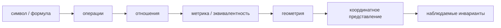
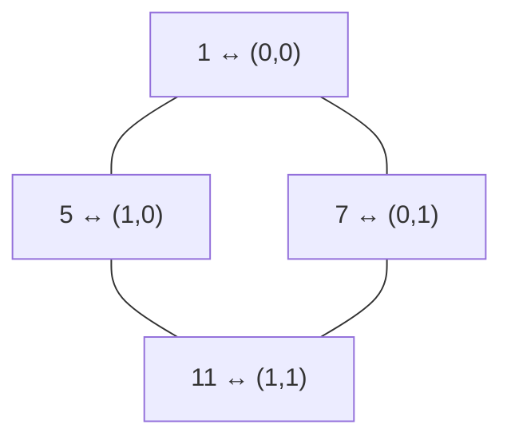
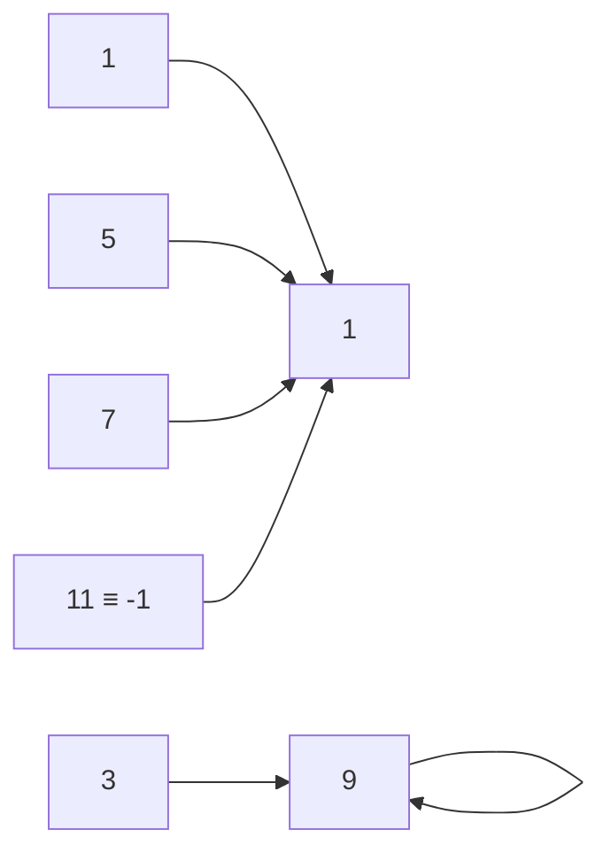
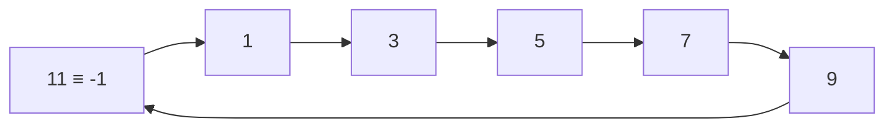
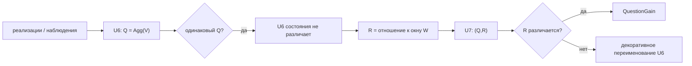
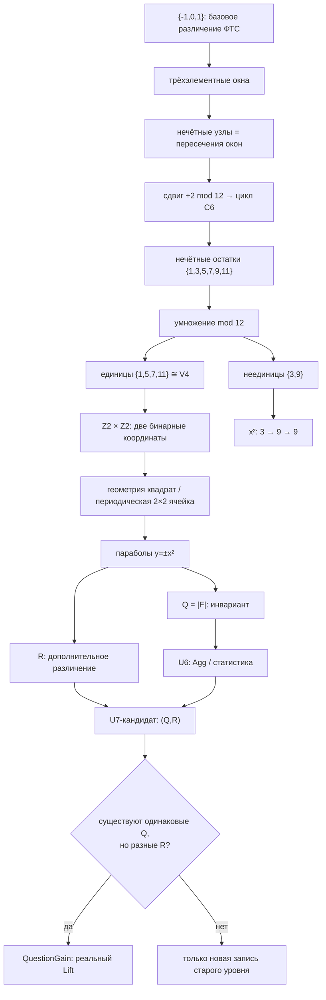

# Аналитический отчёт: четыре Shorts, ФТС, \(U6\to U7\), группа Клейна, дискретный тор и арифметика modulo \(12\)

## Executive summary

Главный результат нашего диалога можно сформулировать жёстче, чем исходное «всё зависит от контекста»:

\[
\boxed{
\text{математический смысл определяется не символом самим по себе, а структурой отношений, операций и инвариантов, в которой он рассматривается}
}
\]

Четыре ролика дают четыре версии этого принципа. В первом одна и та же последовательность получает разное поведение при смене метрики или способа продолжения функции; во втором дискретные арифметические отношения рассматриваются как возможный источник геометрии; в третьем парабола отделяется от конкретной формулы \(y=x^2\); в четвёртом координатное преобразование показывает, как одна геометрическая структура получает разные формульные представления. Первый ролик действительно индексируется как материал об analytic continuation и \(p\)-адических числах; второй — как *How Prime Numbers Unfold Into Geometry* с подписью *Topological unfolding of arithmetic trajectories*; третий — как «Где живут параболы?». Содержание четвёртого здесь реконструируется по вашему уточнению, поскольку его метаданные независимо восстановить не удалось. citeturn0search0turn13search1turn14search0

Для ФТС наиболее сильный вывод касается \(U6\to U7\). Если

\[
U6:\quad Q=x^2
\]

и наивно

\[
U7:\quad -x^2,
\]

то информационного подъёма нет:

\[
-x^2=h(x^2),\qquad h(q)=-q.
\]

Обе записи индуцируют одно и то же разбиение входов \(x\sim -x\). Поэтому сам минус перед квадратом не может быть содержанием нового уровня. **Настоящий \(U7\) должен вводить второй канал различения \(R\), который не восстанавливается однозначно из \(Q\).**

Рабочая гипотеза из диалога тогда принимает вид

\[
\boxed{U6=Q,\qquad U7=(Q,R)}
\]

с операциональным критерием:

\[
\exists\omega_1,\omega_2:
\quad
Q(\omega_1)=Q(\omega_2),
\qquad
R(\omega_1)\neq R(\omega_2).
\]

Это и есть минимальная строгая версия `QuestionGain`: новый уровень различает хотя бы два состояния, которые старый уровень склеивал.

Группа Клейна возникает рядом с этой конструкцией не метафорически, а как точная алгебра двух независимых бинарных различий:

\[
V_4\cong\mathbb Z_2\times\mathbb Z_2.
\]

В арифметике modulo \(12\)

\[
(\mathbb Z/12\mathbb Z)^\times=\{1,5,7,11\}
\]

и все четыре элемента удовлетворяют

\[
x^2\equiv1\pmod{12}.
\]

Они образуют \(V_4\). При этом \(-1\) **не выпадает**:

\[
-1\equiv11\pmod{12}.
\]

Настоящие исключения среди нечётных остатков — \(3\) и \(9\). Они необратимы, являются делителями нуля и удовлетворяют

\[
3^2\equiv9,\qquad9^2\equiv9\pmod{12}.
\]

Причём \(9\) — идемпотент, а \(3\) при итерации квадрата попадает в него:

\[
3\longrightarrow9\longrightarrow9.
\]

Таким образом, квадрат отображает шесть нечётных остатков в два устойчивых режима:

\[
\{1,5,7,11\}\to1,
\qquad
\{3,9\}\to9.
\]

Однако из этого **не следует**, что \(U3\) и \(U9\) обязаны иметь особую семантику. Это становится содержательным для ФТС только после доказательства, что modulo \(12\), умножение modulo \(12\) и конкретная нумерация уровней являются внутренними операциями модели, а не выбранными после просмотра красивого паттерна.

| Утверждение | Статус |
|---|---|
| \(p\)-адическая метрика меняет понятие близости и сходимости | строгая математика |
| \(\zeta(-1)=-1/12\) относится к аналитическому продолжению, а не обычной сумме \(1+2+3+\cdots\) | строгая математика |
| \(\{1,5,7,11\}=(\mathbb Z/12\mathbb Z)^\times\cong V_4\) | строгая математика |
| \(3,9\) — единственные нечётные неединицы modulo \(12\) | строгая математика |
| \(V_4\cong\mathbb Z_2^2\) можно читать как минимальную периодическую \(2\times2\) решётку | строго как алгебраическая/периодическая модель; графовый случай \(2\times2\) вырожден |
| \(x^2\to -x^2\) само по себе даёт `QuestionGain` | **нет** |
| \(U7=(Q,R)\) может дать `QuestionGain` | гипотеза с точным критерием проверки |
| нечётные уровни ФТС являются узлами обратной связи | гипотеза; перекрытие окон это поддерживает, но не доказывает |
| \(U3,U9\) семантически выделены потому, что \(3,9\notin V_4\) | пока нумерологическая гипотеза |
| конструкция Karazoupis доказала происхождение континуума или RH | **не установленный результат**; текущая версия — нерецензированный preprint, RH официально остаётся нерешённой |

## Четыре ролика и общий метапринцип

### Аналитическое продолжение и \(p\)-адические числа

Первый Short индексируется как **Making Sense of Nonsense: Analytic Continuation/p-adic Numbers**; его описание прямо говорит об осмыслении значений расходящихся рядов через аналитическое продолжение и о \(p\)-адических числах. citeturn0search0

Здесь важно не смешивать две математически разные операции.

Для дзета-функции Римана исходный ряд

\[
\zeta(s)=\sum_{n=1}^{\infty}n^{-s}
\]

сходится при

\[
\Re(s)>1.
\]

Далее сама функция продолжается мероморфно на комплексную плоскость с единственным простым полюсом в \(s=1\); это именно аналитическое продолжение функции, а не утверждение, что исходный ряд внезапно стал обычным сходящимся рядом вне своей области сходимости. NIST DLMF фиксирует это определение явно. citeturn2search0

Для отрицательных целых DLMF даёт

\[
\zeta(-n,a)=-\frac{B_{n+1}(a)}{n+1}.
\]

При \(a=1,n=1\):

\[
\zeta(-1)=-\frac1{12}.
\]

Поэтому запись

\[
1+2+3+\cdots\;\overset{\zeta}{=}\;-\frac1{12}
\]

допустима как сокращённая запись **дзета-регуляризованного значения**, но не как равенство обычной суммы ряда: его частичные суммы растут без ограничения. citeturn11search2turn2search0

У \(p\)-адических чисел механизм иной. Для простого \(p\)

\[
|x|_p=p^{-v_p(x)},
\]

где \(v_p(x)\) измеряет степень \(p\), входящую в \(x\). Эта абсолютная величина неархимедова:

\[
|x+y|_p\leq\max(|x|_p,|y|_p),
\]

а \(\mathbb Q_p\) получается завершением \(\mathbb Q\) по этой метрике. Такое стандартное определение используется и в современной математической литературе. citeturn9search8turn15search9

Например,

\[
1+2+4+\cdots
\]

в \(\mathbb R\) расходится, но для частичных сумм

\[
S_N=2^{N+1}-1
\]

имеем

\[
|S_N-(-1)|_2
=
|2^{N+1}|_2
=
2^{-(N+1)}
\to0,
\]

поэтому

\[
1+2+4+8+\cdots=-1
\qquad\text{в }\mathbb Q_2.
\]

То есть первый ролик даёт две версии одной метаидеи:

\[
\boxed{
\text{значение/сходимость неотделимы от выбранной математической структуры}
}
\]

но **аналитическое продолжение и \(p\)-адическое завершение нельзя считать одной и той же процедурой**.

### «Простые числа разворачиваются в геометрию»

Глубокая проверка заставляет здесь поправить наш ранний диалог. YouTube индексирует Short `R0u4RtJkWlo` как **How Prime Numbers Unfold Into Geometry**, а подпись — как **Topological unfolding of arithmetic trajectories**. В доступной индексируемой информации прямой связи этого ролика с работой Miltiadis Karazoupis обнаружить не удалось. Поэтому далее Karazoupis рассматривается как **релевантный математический контекст, который мы привлекли в диалоге**, а не как установленный первоисточник данного Short. citeturn12search25turn13search1

Тем не менее концептуальная связь очевидна и полезна: вместо схемы

\[
\text{готовое пространство}\to\text{точки и расстояния}
\]

рассматривается обратная:

\[
\text{дискретные отношения}
\to
\text{метрика}
\to
\text{геометрия}.
\]

Именно такую программу реализует свежий preprint Karazoupis **The Principle of Emergent Continuity: A Proof of the Emergence of the Mathematical Continuum from the Arithmetic of Prime Numbers**. Текущая версия v3 опубликована 30 марта 2026 года и прямо маркирована издательской платформой как **NOT PEER-REVIEWED**. citeturn5search17turn3search1

Это важный контекст для ФТС: геометрия может быть не исходным контейнером объектов, а макроскопическим кодом отношений между ними. Но это — общий математический мотив; конкретные сильные утверждения Karazoupis требуют отдельной проверки.

### «Где живут параболы?»

Третий Short индексируется как **«Где живут параболы?»** на канале Wild Mathing. citeturn14search0

Его существенная идея — различие между объектом и координатным представлением объекта.

Парабола не тождественна записи

\[
y=x^2.
\]

Геометрически её можно определить как множество точек \(P\), равноудалённых от фиксированной точки \(F\) — фокуса — и фиксированной прямой \(d\) — директрисы:

\[
\operatorname{dist}(P,F)
=
\operatorname{dist}(P,d).
\]

Стандартная справочная формулировка через фокус, директрису, ось и параметр приводится в Encyclopedia of Mathematics. citeturn2search2

Например,

\[
x^2=4py
\]

имеет фокус

\[
F=(0,p)
\]

и директрису

\[
y=-p.
\]

Для \(y=x^2\)

\[
p=\frac14.
\]

Следовательно,

\[
y=x^2
\]

— не «сама парабола», а координатная реализация более инвариантного геометрического отношения.

### Скрытая геометрия и сдвиг парабол

Содержание четвёртого Short в отчёте основано на вашем уточнении: **«как скрытая геометрия сдвигает параболы»**; индексируемое содержимое самого ID независимо получить не удалось.

Ключевая операция:

\[
y=x^2
\longrightarrow
y=(x-h)^2+k.
\]

Это перенос координат:

\[
X=x-h,\qquad Y=y-k,
\]

после которого снова

\[
Y=X^2.
\]

Ещё показательнее общий квадратный трёхчлен:

\[
y=ax^2+bx+c.
\]

Дополнение до квадрата даёт

\[
y
=
a\left(x+\frac{b}{2a}\right)^2
+
c-\frac{b^2}{4a}.
\]

Следовательно,

\[
h=-\frac{b}{2a},
\qquad
k=c-\frac{b^2}{4a}.
\]

Линейный коэффициент \(b\), который алгебраически выглядит просто членом полинома, кодирует положение оси параболы. «Скрытая геометрия» здесь — не мистическая сущность, а структура, которая становится явной после подходящей смены координат.

### Единый принцип

Четыре сюжета можно собрать в одну цепочку:

И наоборот:

\[
\boxed{
\text{конкретная запись}
\neq
\text{структура, которую она представляет}
}
\]

Но здесь нужен важный предохранитель от философской халтуры. «Смысл зависит от контекста» **не** значит «любое толкование допустимо». Новый контекст должен быть задан формально: новой метрикой, операцией, отображением, отношением эквивалентности, группой преобразований и набором сохраняемых инвариантов. Иначе вместо структурной математики мы получаем очень дорогую разновидность гадания по формулам.

## Математический каркас и пределы аналогий

### \(p\)-адическая геометрия как смена понятия близости

Если

\[
x=p^k\frac ab,
\qquad p\nmid ab,
\]

то

\[
v_p(x)=k,
\qquad
|x|_p=p^{-k}.
\]

Чем на более высокую степень \(p\) делится разность \(x-y\), тем **ближе** \(x\) и \(y\) в \(p\)-адической метрике:

\[
d_p(x,y)=|x-y|_p.
\]

Это даёт очень точную версию метапринципа первого ролика:

\[
\boxed{
\text{сходимость — свойство последовательности вместе с метрикой, а не последовательности самой по себе}
}
\]

Современные исследовательские публикации формулируют \(\mathbb Q_p\) именно как завершение \(\mathbb Q\) относительно \(p\)-адической нормы. citeturn9search8turn15search9

### Что именно делает Karazoupis

В v3 Karazoupis берёт простые числа как вершины дискретной системы. Для пары \(p_i,p_j\) вводится арифметический зазор

\[
g=|p_j-p_i|
\]

и используются \(p\)-адические оценки этого зазора. В тексте preprint определена метрика вида

\[
d_n^A(p_i,p_j)
=
\frac1{p_n}
\prod_{k=1}^{n}|g|_{p_k}^{-1}.
\]

Автор апеллирует к product formula для норм и утверждает, что локальная арифметическая геометрия стабилизируется при росте системы. citeturn4view0

Далее preprint заявляет последовательность

\[
\mathcal G_n=(P_n,d_n^A,\mu_n)
\]

и утверждает её сходимость в своей coarse Gromov–Hausdorff постановке к полному связному геодезическому пространству \(C_A\), названному Arithmetic Continuum. citeturn4view4

Затем делается гораздо более сильный шаг: автор заявляет спектральную статистику типа GUE и геометрическое доказательство гипотезы Римана. Сам текст при этом называет используемый лапласиан **non-Hermitian** и отдельно предвосхищает стандартное возражение о том, что GUE относится к эрмитовым ансамблям; ответ автора состоит в переинтерпретации этой проблемы внутри собственной онтологии. citeturn4view2turn4view3

Это следует читать исключительно как **заявления автора preprint**. Работа по состоянию на 1 октября 2026 года остаётся нерецензированной, а Clay Mathematics Institute по-прежнему официально классифицирует гипотезу Римана как **Unsolved**. citeturn3search1turn2search3

Поэтому для ФТС из Karazoupis стоит брать не «доказанный результат», а методологический шаблон:

\[
\boxed{
\text{локальные отношения}
\to
\text{операциональная метрика}
\to
\text{глобальная геометрия}
}
\]

Это ровно тот тип перехода, который в ФТС может оказаться полезен.

### Парабола как инвариант относительно преобразований

Рассмотрим пару

\[
F_+(x)=x^2,
\qquad
F_-(x)=-x^2.
\]

Они переходят друг в друга отражением

\[
(x,y)\mapsto(x,-y).
\]

Следовательно, минус не создаёт новый уровень геометрической сложности: он меняет ориентацию относительно оси.

То же самое со сдвигом:

\[
y=x^2
\quad\leftrightarrow\quad
y=(x-h)^2+k.
\]

Из этого следует важный отрицательный результат для ФТС:

\[
\boxed{
x^2\to -x^2
\text{ сам по себе не может служить доказательством }
U6\to U7.
}
\]

Если переход действительно повышает выразительность, дополнительная структура должна находиться **не в знаке формулы как таковом**, а в новой операции чтения этой формы.

## Modulo \(12\), \(V_4\), дискретный тор и числа \(-1,3,9\)

### Почему именно \(\{1,5,7,11\}\)

Единицы кольца

\[
\mathbb Z_{12}=\mathbb Z/12\mathbb Z
\]

— элементы, взаимно простые с \(12\):

\[
(\mathbb Z/12\mathbb Z)^\times
=
\{1,5,7,11\}.
\]

Их таблица умножения:

| \(\times\pmod{12}\) | \(1\) | \(5\) | \(7\) | \(11\) |
|---:|---:|---:|---:|---:|
| **1** | 1 | 5 | 7 | 11 |
| **5** | 5 | 1 | 11 | 7 |
| **7** | 7 | 11 | 1 | 5 |
| **11** | 11 | 7 | 5 | 1 |

Каждый нетривиальный элемент имеет порядок \(2\):

\[
5^2\equiv7^2\equiv11^2\equiv1\pmod{12}.
\]

Следовательно,

\[
(\mathbb Z/12\mathbb Z)^\times
\cong
C_2\times C_2
=
V_4.
\]

Удобный изоморфизм:

| mod \(12\) | \(\mathbb Z_2\times\mathbb Z_2\) |
|---:|:---:|
| \(1\) | \((0,0)\) |
| \(5\) | \((1,0)\) |
| \(7\) | \((0,1)\) |
| \(11\) | \((1,1)\) |

При этом умножение modulo \(12\) переходит в покоординатное сложение modulo \(2\). Например,

\[
5\cdot7\equiv11
\]

соответствует

\[
(1,0)+(0,1)=(1,1).
\]

Это и есть четверная группа Клейна, безо всякой символической алхимии.

### Почему появляется дискретный тор

В исследовательской литературе \(d\)-мерный дискретный тор обычно строится на вершинах

\[
(\mathbb Z/L\mathbb Z)^d
\]

с периодическими переходами по координатам; эквивалентно — как Cayley-граф произведения конечных циклических групп. citeturn7search0turn7search2

Поэтому в **алгебраическом** смысле

\[
\mathbb Z_2\times\mathbb Z_2
\]

можно читать как минимальную \(2\times2\) периодическую решётку:

\[
T_{2,2}^{\mathrm{alg}}
=
\mathbb Z_2\times\mathbb Z_2.
\]

Но необходимо оговорить вырождение: при размере \(2\) шаг \(+1\) и шаг \(-1\) по данной координате приводят к одной и той же соседней вершине. Поэтому если удалить кратные рёбра и требовать обычный простой граф, «тороидальная решётка \(2\times2\)» вырождается в \(C_4\), а не является обычной невырожденной четырёхрегулярной тороидальной сеткой. Стандартное определение через разность \(\pm1\bmod L\) делает эту особенность \(L=2\) явной. citeturn7search0

Поэтому для ФТС безопаснее формулировка:

\[
\boxed{
V_4
\text{ — это минимальная двумерная периодическая бинарная координатная система,}
}
\]

а не буквальное «\(V_4\) является топологическим тором».

### Что на самом деле происходит с \(-1,3,9\)

Ключевая поправка:

\[
\boxed{-1\text{ не исключён из }V_4.}
\]

В \(\mathbb Z_{12}\)

\[
-1\equiv11,
\]

поэтому

\[
(-1)^2\equiv1\pmod{12}
\]

и \(-1\) представляет элемент \(11\in V_4\).

Рассмотрим все нечётные остатки:

| \(x\) | \(\gcd(x,12)\) | \(x^2\bmod12\) | обратим? | идемпотент? |
|---:|---:|---:|:---:|:---:|
| \(1\) | 1 | 1 | да | да |
| \(3\) | 3 | 9 | нет | нет |
| \(5\) | 1 | 1 | да | нет |
| \(7\) | 1 | 1 | да | нет |
| \(9\) | 3 | 9 | нет | **да** |
| \(11=-1\) | 1 | 1 | да | нет |

Следовательно, на нечётной части \(\mathbb Z_{12}\) квадрат задаёт чрезвычайно простое разбиение:

\[
x^2\equiv
\begin{cases}
1\pmod{12},&x\in\{1,5,7,11\},\\[2mm]
9\pmod{12},&x\in\{3,9\}.
\end{cases}
\]

То есть

\[
\boxed{
\{1,5,7,11\}
=
\{x\ \text{нечётный}:x^2\equiv1\pmod{12}\}
}
\]

и

\[
\boxed{
\{3,9\}
=
\{x\ \text{нечётный}:x^2\equiv9\pmod{12}\}.
}
\]

Динамика

\[
S(x)=x^2\pmod{12}
\]

имеет вид:

То есть после одного квадрирования вся нечётная подсистема попадает в один из двух неподвижных идемпотентов:

\[
1^2=1,
\qquad
9^2=9.
\]

\(9\) действительно идемпотент:

\[
9^2\equiv9\pmod{12},
\]

а \(3\) — нет; он лишь попадает в \(9\).

У кольца \(\mathbb Z_{12}\) на самом деле четыре идемпотента:

\[
0,\;1,\;4,\;9.
\]

Это непосредственно следует и из китайской теоремы об остатках:

\[
\mathbb Z_{12}
\cong
\mathbb Z_3\times\mathbb Z_4.
\]

Для интересующих нас нечётных чисел:

| \(x\) | \(x\bmod3\) | \(x\bmod4\) |
|---:|---:|---:|
| 1 | 1 | 1 |
| 3 | **0** | 3 |
| 5 | 2 | 1 |
| 7 | 1 | 3 |
| 9 | **0** | 1 |
| 11 | 2 | 3 |

Это полностью демистифицирует исключительность \(3\) и \(9\): **среди нечётных остатков именно они кратны \(3\)**. Координата modulo \(4\) у всех нечётных элементов обратима; \(3\) и \(9\) ломаются только в компоненте \(\mathbb Z_3\).

Поэтому квадрат Клейна здесь имеет буквально декартову форму:

\[
\{1,2\}_{\bmod3}
\times
\{1,3\}_{\bmod4},
\]

то есть

\[
2\times2.
\]

А \(3\) и \(9\) находятся на дополнительной «линии»

\[
0_{\bmod3}\times\{1,3\}_{\bmod4}.
\]

Это очень хорошая геометрическая визуализация, но она ещё не является семантикой ФТС.

### Нечётные окна и цикл \(C_6\)

Ваши трёхэлементные окна имеют форму

\[
W_k=(2k-1,\;2k,\;2k+1).
\]

Их сумма:

\[
\Sigma W_k
=
(2k-1)+2k+(2k+1)
=
6k.
\]

Отсюда последовательность

\[
0,6,12,18,24,30
\]

не случайна:

\[
\boxed{\Sigma W_k=3\cdot\text{центр}(W_k)}.
\]

Ещё важнее, соседние окна пересекаются **ровно по нечётному уровню**:

\[
W_k\cap W_{k+1}
=
\{\,2k+1\,\}.
\]

Например,

\[
(1,2,3)\cap(3,4,5)=\{3\}.
\]

Поэтому нечётные уровни действительно имеют привилегированную **комбинаторную роль интерфейсов между соседними окнами**. Это уже строгий факт о заданной вами схеме. Но из «интерфейс» ещё не следует «обратная связь»: для feedback требуется направление переходов и цикл.

При quotient modulo \(12\) последовательность интерфейсов:

\[
1\to3\to5\to7\to9\to11\to1.
\]

Это шестичленный цикл действия

\[
T(x)=x+2\pmod{12}.
\]

Строгая формулировка немного тоньше прежней: множество нечётных остатков **не является аддитивной подгруппой** \(\mathbb Z_{12}\); это косет чётной подгруппы. Но действие генератора \(+2\) на нём образует шеститактную циклическую динамику, эквивалентную действию \(C_6\).

И поверх этого аддитивного цикла возникает **другая**, мультипликативная классификация:

\[
\underbrace{\{1,5,7,11\}}_{\text{единицы }V_4}
\qquad\sqcup\qquad
\underbrace{\{3,9\}}_{\text{неединицы}}.
\]

Это одна из самых содержательных находок диалога:

\[
\boxed{
\text{одна и та же нумерация одновременно поддерживает
аддитивную циклическую и мультипликативную структуры.}
}
\]

Но операции различны — \(+2\) и \(\times\bmod12\). Смешивать их без явного перехода нельзя.

## ФТС и переход \(U6\to U7\)

### От квадрата как агрегации к потере различимости

В рабочей интерпретации диалога \(U6\) — статистика/агрегация. Квадратная форма

\[
Q(x)=x^2
\]

подходит этому неожиданно хорошо, потому что

\[
Q(x)=Q(-x).
\]

То есть отображение забывает знак носителя:

\[
x\sim_6-x.
\]

Это можно читать как простейший quotient:

\[
\{+x,-x\}\longmapsto x^2.
\]

В более абстрактной записи:

\[
Q(\omega)=Agg_i(V_i(\omega)).
\]

Статистический уровень преобразует множество реализаций в инвариант.

Именно поэтому парабола оказывается полезной моделью \(U6\), а не просто красивым рисунком:

\[
\boxed{
U6
\sim
\text{построение инварианта путём склейки различимых реализаций}.
}
\]

### Почему \(-x^2\) недостаточно для \(U7\)

Пусть

\[
q_6(x)=x^2
\]

и

\[
q_7(x)=-x^2.
\]

Тогда

\[
q_7=h\circ q_6,
\qquad
h(z)=-z.
\]

Поэтому

\[
q_6(x_1)=q_6(x_2)
\iff
q_7(x_1)=q_7(x_2).
\]

Оба уровня индуцируют **одинаковые классы неразличимости**.

Иными словами:

\[
\boxed{
x^2\to -x^2
\text{ является преобразованием представления, а не увеличением информации.}
}
\]

Это, пожалуй, важнейший отрицательный вывод всего исследования: если ФТС утверждает реальный подъём выразительности \(U6\to U7\), то математическое содержание этого подъёма необходимо искать **за пределами самого зеркального минуса**.

### Где возникает \(V_4\)

Для фиксированного \(r>0\) рассмотрим четыре точки:

\[
(+\sqrt r,+r),
\quad
(-\sqrt r,+r),
\quad
(+\sqrt r,-r),
\quad
(-\sqrt r,-r).
\]

Есть две независимые инволюции:

\[
s_x(x,y)=(-x,y)
\]

и

\[
s_y(x,y)=(x,-y).
\]

Они удовлетворяют

\[
s_x^2=s_y^2=e,
\qquad
s_xs_y=s_ys_x.
\]

Следовательно,

\[
\{e,s_x,s_y,s_xs_y\}
\cong
V_4.
\]

Можно ввести две бинарные координаты:

\[
\beta=\operatorname{sgn}x,
\qquad
\rho=\operatorname{sgn}y.
\]

Тогда для \(r>0\)

\[
(\beta,\rho)\in\{-1,+1\}^2
\cong
\mathbb Z_2^2.
\]

Первая координата говорит, какая ветвь \(x\) была склеена квадратом; вторая — в какой зеркальной ориентации находится парабола.

Таким образом, \(V_4\) — естественная **локальная геометрия двух независимых бинарных различий** рядом с квадратной формой.

Но в точке

\[
r=0
\]

все четыре формальных варианта сходятся в

\[
(0,0).
\]

Знак \(x\) и знак \(y\) там не определяют независимые ветви. Поэтому \(V_4\)-волокно существует только **вне нулевой границы** и вырождается в нуле. Это важнее, чем просто красивая картинка квадрата.

### Каналы \(Q\) и \(R\)

Отсюда возникла рабочая декомпозиция:

\[
Q(F)=|F|,
\]

\[
R(F)=\frac{F}{|F|}
\qquad(F\neq0).
\]

Для зеркальной пары

\[
F_+=x^2,
\qquad
F_-=-x^2
\]

имеем:

\[
Q(F_+)=Q(F_-)=x^2,
\]

но

\[
R(F_+)=+1,
\qquad
R(F_-)=-1.
\]

То есть \(Q\) отвечает за величину/инвариант, \(R\) — за ориентацию.

Можно естественно продолжить второй канал в ноль функцией знака:

\[
R(F)=\operatorname{sgn}F
\in\{-1,0,+1\}.
\]

Формально это неожиданно хорошо рифмуется с вашей исходной тройкой

\[
(-1,0,1)
\]

и семантическим кодированием «неизвестное / ошибка-допущение / сигнал-аксиома». Но **арифметическое совпадение не устанавливает семантического тождества**. Чтобы отождествить эти вещи, необходимо определить величину \(F\), знак которой операционально означает именно эти три состояния.

### Настоящий `QuestionGain`

Пусть \(\Omega\) — пространство состояний системы.

Уровень \(U6\) задаёт наблюдение

\[
q_6:\Omega\to A.
\]

Оно определяет отношение эквивалентности:

\[
\omega_1\sim_6\omega_2
\iff
q_6(\omega_1)=q_6(\omega_2).
\]

Пусть \(U7\) задаёт

\[
q_7:\Omega\to B.
\]

Минимальный критерий реального прироста различимости:

\[
\boxed{
\exists\omega_1,\omega_2:
q_6(\omega_1)=q_6(\omega_2)
\land
q_7(\omega_1)\neq q_7(\omega_2).
}
\]

То есть разбиение \(U7\) должно быть строго тоньше разбиения \(U6\).

Если же существует функция \(h\), такая что

\[
q_7=h\circ q_6,
\]

то \(U7\) не знает ничего принципиально нового о состоянии мира.

Поэтому:

\[
q_7=-q_6
\]

проваливает тест.

Более содержательная модель:

\[
\boxed{
q_7(\omega;W)
=
\bigl(
Q(\omega),
R(\omega;W)
\bigr),
}
\]

где

\[
Q(\omega)=Agg(V(\omega))
\]

и

\[
R(\omega;W)
\]

характеризует отношение полученного результата к **окну ожидания** \(W\).

Здесь ваш рабочий принцип

\[
Answer(W)=Close(W,W)
\]

становится понятнее: знание должно включать не просто статистическую величину, а операцию проверки замыкания ожидания.

Однако для строгой модели лучше сначала типизировать оператор:

\[
Close:\mathcal W\times\mathcal E\to\mathcal R,
\]

где \(\mathcal W\) — пространство ожиданий, \(\mathcal E\) — свидетельств, а \(\mathcal R\) — пространство результатов закрытия.

Например,

\[
\mathcal R=\{-1,0,+1\}
\]

или

\[
\mathcal R=\{open,closed\}.
\]

Только после этого выражение вроде

\[
Close(W,W)
\]

можно проверять на математический смысл, а не читать как красивую самореференцию.

### Связь с вашими нечётными окнами

Ваши окна

\[
(-1,0,1),\;
(1,2,3),\;
(3,4,5),\;
(5,6,7),\;
(7,8,9),\;
(9,10,11)
\]

имеют интересное свойство: всякий нечётный внутренний уровень одновременно является **выходной границей одного окна и входной границей следующего**.

Например,

\[
U7\in(5,6,7)\cap(7,8,9).
\]

Поэтому \(U7\) математически находится не просто «после статистики»:

\[
U6\to U7.
\]

Он является шарнирной точкой между

\[
(U5,U6,U7)
\]

и

\[
(U7,U8,U9).
\]

Это делает предположение об особой роли нечётных уровней значительно интереснее. Но строгая версия должна звучать так:

\[
\boxed{
\text{нечётные уровни являются узлами перекрытия трёхэлементных окон;}
}
\]

а «они осуществляют обратную связь» — это уже дополнительная гипотеза, которую нужно доказывать направленной динамикой.

Ещё более конкретно для интересующей пары:

\[
(5,6,7)
=
(\text{Выбор},\text{Статистика},\text{Знание}).
\]

Если схема корректна, \(U7\) действительно занимает положение, где агрегат \(U6\) должен быть **возвращён в контекст более высокого окна**. Именно здесь оператор \(R(W,\cdot)\) выглядит естественнее простого \(-x^2\).

## Проверяемые гипотезы, эксперименты и риски

### Что имеет смысл проверять в первую очередь

Самый важный тест — **каноничность нумерации**. Если числа уровней действительно несут структуру, нумерация должна быть восстановима из отношений между уровнями хотя бы с точностью до небольшой группы допустимых симметрий. Иначе произвольная перестановка номеров сохранит ФТС, но уничтожит modulo-\(12\) эффекты, а значит эффекты принадлежат обозначениям, а не теории.

Практический тест: построить ненумерованный граф уровней и операций, затем проверить, выводится ли разметка

\[
-1,0,1,\ldots,11
\]

из его внутренних свойств. Сильный результат — единственность с точностью, например, до

\[
n\mapsto n+c
\]

или

\[
n\mapsto -n+c.
\]

Слабый результат — номера назначаются извне.

Второй тест — **обоснование modulo \(12\)**. Нужно показать преобразование \(T\), при котором состояния, различающиеся на \(12\),

\[
U_n,\quad U_{n+12},
\]

эквивалентны относительно определённых операций ФТС. Если никакой такой периодичности нет, mod \(12\) является аналитической линзой, а не внутренним законом теории.

Третий тест — **операциональный смысл умножения modulo \(12\)**. Для \(V_4\) мало заметить

\[
5\cdot7=11\pmod{12}.
\]

Нужна операция композиции уровней или преобразований

\[
\circ
\]

такая, что отображение

\[
\phi:U_n\mapsto[n]_{12}
\]

удовлетворяет хотя бы на интересующей подсистеме

\[
\phi(A\circ B)
=
\phi(A)\phi(B)\pmod{12}.
\]

Без гомоморфизма \(V_4\) остаётся корректным фактом об **индексах**, но не о семантике ФТС.

Четвёртый тест — **обратная связь нечётных уровней**. Само перекрытие окон уже доказано:

\[
W_k\cap W_{k+1}=\{U_{2k+1}\}.
\]

Для feedback необходимо дополнительно определить направленные отображения

\[
W_k\to U_{2k+1}\to W_{k+1}
\]

и обратный путь, замыкающий цикл. Лучший эмпирический тест — вмешательство: изменить состояние нечётного узла при фиксированных соседних чётных уровнях и проверить, меняется ли последующее состояние предыдущего/следующего окна.

Пятый тест — **QuestionGain \(U6\to U7\)**. Нужны пары наблюдений

\[
\omega_1,\omega_2
\]

с одинаковой статистикой:

\[
Q(\omega_1)=Q(\omega_2),
\]

но различным знанием:

\[
R(\omega_1;W)\neq R(\omega_2;W).
\]

Если таких пар нет и \(R=f(Q)\), новый уровень избыточен.

Для вероятностической/данной модели более сильная проверка:

\[
I(Y;R\mid Q)>0,
\]

где \(Y\) — независимо заданная целевая переменная. На практике вместо абстрактной взаимной информации можно сравнить out-of-sample log-loss моделей

\[
Y\sim Q
\]

и

\[
Y\sim(Q,R).
\]

Прибавка должна воспроизводиться на новых данных, иначе философия опять убежала вперёд статистики, что было бы довольно иронично именно на переходе от «Статистики» к «Знанию».

Шестой тест касается `Close`. Если это именно **оператор замыкания**, а не просто имя для булевого решения, следует проверить стандартные свойства кандидата:

\[
W\preceq Close(W),
\]

\[
W_1\preceq W_2
\Rightarrow
Close(W_1)\preceq Close(W_2),
\]

\[
Close(Close(W))=Close(W).
\]

Если эти свойства не предполагаются, лучше честно назвать `Close` предикатом/решателем, чтобы не вносить ненужную математическую семантику.

### Нулевая гипотеза против нумерологии

Для проверки арифметической части нужен обязательный контроль на множественные совпадения.

Почему \(12\)? Если потому что именно для \(12\) получился \(V_4\), это selection bias. Если \(12\) заранее следует из периода системы — это уже другое дело.

Нужно сравнить соседние модули:

\[
m=8,10,11,12,13,14,16,\ldots
\]

и заранее определить критерий «структурно интересного совпадения». Например, заметим, что

\[
(\mathbb Z/8\mathbb Z)^\times
=
\{1,3,5,7\}
\cong V_4
\]

тоже даёт группу Клейна. Поэтому само появление \(V_4\) не делает число \(12\) уникальным.

Сила \(12\) в вашей модели должна идти не из существования \(V_4\), а из **независимого происхождения периода \(12\)** плюс последующего появления \(V_4\).

То же касается \(3\) и \(9\). Их исключительность modulo \(12\) сводится к очень простой причине:

\[
3\mid3,\qquad3\mid9.
\]

Поэтому заявление

> «\(U3\) и \(U9\) особые, потому что арифметика их выделила»

пока слишком сильное.

Более корректная гипотеза:

> «если \(U3\) и \(U9\) независимо окажутся операционально особыми, то их арифметическая выделенность modulo \(12\) становится дополнительным инвариантом, который стоит объяснить».

Порядок причинности здесь критичен.

### Как отличить реальную структуру от красивого совпадения

Предлагается такой минимальный falsification protocol:

| Проверка | ФТС-структура подтверждается, если… | Нумерологическая версия, если… |
|---|---|---|
| Каноничность номера | номер выводится из операций | номер можно произвольно переставить |
| Mod \(12\) | период \(12\) задан независимо | \(12\) выбран после наблюдения паттерна |
| \(V_4\) | умножение соответствует композиции операций | умножаются только числовые ярлыки |
| \(3,9\) | имеют независимую операциональную особенность | выделяются только потому, что кратны \(3\) |
| Нечётные узлы | участвуют в замкнутом направленном feedback | лишь являются пересечениями окон |
| \(U7\) | различает состояния с одинаковым \(U6\) | является \(h(U6)\) |
| \(R\) | варьирует при фиксированном \(Q\) и предсказывает новое | постоянная метка «минус» |
| `Close` | имеет формальный тип и проверяемые свойства | остаётся философским словом |

### Главное ограничение конструкции \(V_4\) для \(U6\to U7\)

Нужно особенно подчеркнуть один момент, который в раннем диалоге был сформулирован слишком оптимистично.

Если определить

\[
\rho=+1
\]

для всего \(U6\) и

\[
\rho=-1
\]

для всего \(U7\), то добавление

\[
(Q,\rho)
\]

ещё **не даёт QuestionGain внутри состояния мира**, потому что \(\rho\) является константой уровня.

То есть:

\[
(Q,+1)\leftrightarrow U6,
\qquad
(Q,-1)\leftrightarrow U7
\]

может хорошо кодировать **различие двух уровней**, но не доказывает, что второй уровень различает больше миров.

Для реального прироста \(R\) должен зависеть от состояния:

\[
R=R(\omega,W),
\]

а не просто от номера уровня.

Это разграничивает две вещи, которые легко спутать:

\[
\boxed{
\text{геометрия пространства представлений}
\neq
\text{информационная мощность уровня}.
}
\]

\(V_4\) убедительно даёт первую. Вторую ещё предстоит доказать.

### Наиболее перспективная рабочая модель

После всех поправок наиболее сильная версия гипотезы ФТС сейчас выглядит так:

\[
\boxed{
U6:
\omega\mapsto Q(\omega)
}
\]

— построение инварианта/статистического агрегата, который склеивает часть различий.

Затем

\[
\boxed{
U7:
(\omega,W)
\mapsto
\bigl(Q(\omega),R(\omega,W)\bigr)
}
\]

— реинтродукция контекстного различия относительно модели ожидания.

При этом:

\[
Q
\]

является «что наблюдалось в агрегате»,

а

\[
R
\]

— «что это означает относительно ожидаемого окна».

Тогда

\[
Answer(W)=Close(W,W)
\]

может быть прочитано не как магическая самоссылка, а как предельный случай, где модель содержит критерий собственного закрытия.

В таком чтении \(U7\) действительно не является ещё одной статистикой. Он добавляет **отношение между статистикой и ожидающей структурой**.

Это хорошо выражает метапринцип всех четырёх роликов:

\[
\boxed{
\text{объект становится содержательно богаче не от добавления символа,
а от добавления новой структуры отношений.}
}
\]

## Приоритетные источники и статус использования

Веб-проверка проводилась с приоритетом первичных, официальных и исследовательских источников. Русскоязычный первичный материал непосредственно доступен для третьего Short; для \(p\)-адической теории, дзета-функции и статуса RH наиболее авторитетные доступные источники англоязычные.

| Источник | Для чего использован | Статус |
|---|---|---|
| **NIST Digital Library of Mathematical Functions, Riemann Zeta Function** | область определения ряда, аналитическое продолжение, мероморфность \(\zeta\) | основной официальный источник citeturn2search0turn10view2 |
| **NIST DLMF, Hurwitz Zeta special values** | \(\zeta(-n,a)=-B_{n+1}(a)/(n+1)\), откуда \(\zeta(-1)=-1/12\) | основной официальный источник citeturn11search2 |
| **AMS/JAMS и современная исследовательская литература по \(p\)-адическим числам** | определение \(|x|_p=p^{-v_p(x)}\), завершение \(\mathbb Q\to\mathbb Q_p\) | использован citeturn9search8turn15search9 |
| **Miltiadis Karazoupis, The Principle of Emergent Continuity, v3** | конструкция prime-agent network, \(p\)-адическая метрика, coarse continuum, заявления о GUE/RH | использован как первичный источник *утверждений автора*; **not peer-reviewed** citeturn3search1turn4view0turn4view4 |
| **Clay Mathematics Institute, Riemann Hypothesis** | текущий официальный статус RH | использован; RH значится **Unsolved** citeturn2search3 |
| **Encyclopedia of Mathematics, Parabola** | контроль геометрического определения параболы | использован как вторичный справочный источник citeturn2search2 |
| **Исследовательские работы о discrete torus** | стандартное представление через конечные циклические координаты и periodic boundary conditions | использованы citeturn7search0turn7search2 |
| **YouTube Short `P21IAO1oghI`** | идентификация первого ролика и темы | использован citeturn0search0 |
| **YouTube Short `R0u4RtJkWlo`** | идентификация второго ролика; уточнение, что доступная подпись — *Topological unfolding of arithmetic trajectories* | использован citeturn13search1 |
| **YouTube Short `WiSPqpTTkRY` / Wild Mathing** | идентификация «Где живут параболы?» | использован citeturn14search0 |
| **YouTube Short `W1vm8JfIwIk`** | содержание «скрытая геометрия сдвигает параболы» | содержание взято из вашего уточнения; независимо не верифицировано |

Прямые ссылки на четыре обсуждавшихся Shorts, как запрошено:

[Making Sense of Nonsense: Analytic Continuation/p-adic Numbers](https://www.youtube.com/shorts/P21IAO1oghI) citeturn0search0

[How Prime Numbers Unfold Into Geometry](https://www.youtube.com/shorts/R0u4RtJkWlo) citeturn13search1

[Где живут параболы?](https://www.youtube.com/shorts/WiSPqpTTkRY) citeturn14search0

[Четвёртый Short — `W1vm8JfIwIk`](https://www.youtube.com/shorts/W1vm8JfIwIk) — тематическая характеристика в этом отчёте основана на вашем описании.

Итоговая схема исследования может быть сведена к одной диаграмме:

Самый сильный итог не в том, что «ФТС неожиданно содержит группу Клейна». Это пока было бы слишком дешёвой победой. Сильнее другое: **диалог позволил получить конкретный критерий, отделяющий содержательный \(U6\to U7\) от декоративного**.

\[
\boxed{
U7\text{ должен не просто преобразовывать }Q,
\text{ а различать хотя бы то, что }Q\text{ уже склеил.}
}
\]

Именно этот критерий превращает цепочку от \(p\)-адических метрик и парабол до \(V_4\), modulo \(12\) и нечётных окон из набора эффектных аналогий в программу, которую уже можно пытаться опровергнуть.