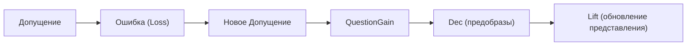
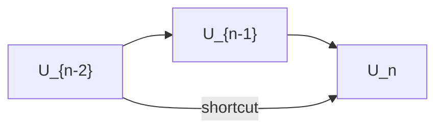
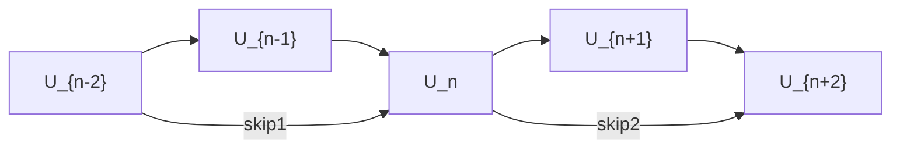

# Исполнительное резюме  
В ходе диалога были сформулированы следующие ключевые идеи и гипотезы: ФТС рассматривается как схема последовательных представлений, сходная с иерархичной **нейросетевой архитектурой с остаточными связями**. На каждом шаге действует цикл «**Допущение → Ошибка → новое Допущение**», где Loss воспринимается не как абсолютная ошибка, а как **доступное свидетельство** расхождения модели с реальностью (карты `M_θ` cоответствуют доступным данным `D`, но никогда не совпадают точно с неизвестной территорией `T`). Представления различают объекты через эквивалентности `q`: если `q(a)=q(b)`, то уровень не различает `a` и `b`; когда новый вопрос обнаруживает `r(a)≠r(b)`, появляется остаток и требуются корректировки (этот переход формализует **QuestionGain**). Нейросетевая аналогия раскрывает, что **чётные** уровни ФТС (например, U2, U4, U6 …) реализуют вычислительные **преобразования** (портретны операции факторизации: `x→x`, `|x|→x^2`, и т. д.), а **нечётные** (U1, U3, U5 …) — **состояния/представления**; переходы между ними чередуются: линейная антиориентация (транспорт знака) и нелинейная перестройка. Это напоминает в нейросети: линейный слой → нелинейность → линейный … , причём в обратном проходе ошибок участвует сопряжённый (транспонированный) оператор. Переход U_{2k+1}=U_{2k-1}⊕R_{2k} (геометрически — «остаточное соединение») сохраняет старое представление и добавляет только новый **остаток** разницы. В совокупности формируется архитектура из **триад** (локальных расчётных блоков с шорткатом) и **пентад** (два блока с перекрытием). Так, один пентад компилирует (сжимает) историю предыдущего пути в новое компактное представление: U3 («Информация») содержит закодированную цепочку [У-1..U2], U7 («Знание») — цепочку [U3..U6], U11 («Я») — цепочку [U7..U10]. **Остаток (Residuum)** и **QuestionGain** обеспечивают эволюцию: если новая информация расходится с застывшим представлением, появляется несводимое отличие, запускается переход Lift. Формализованы операторы: 

- `q: X→Q` – проекция-раскладка представления, 
- `Dec_q = q^{-1}` – отображение на множество прообразов (разложение класса эквивалентности), 
- `Anti(W)=(W-W^T)/2` – антисимметричная часть оператора. 

Это даёт возможность рассматривать транспонирование (сопровождающее backprop) не просто как знак `-`, а как выделение симметричной и антисимметричной компонент (для любого квадратного W: `W=(W+W^T)/2 + (W-W^T)/2`). Замечено, что оба предела «каждый сам себе» (переподгонка) и «всё одно» (тотализация) уничтожают QuestionGain: в первом нечему схлопываться, во втором нечего разворачивать.  

**Рекомендации:** Формализовать операторы `Dec_q` и `Anti`, проверить на экспериментальных моделях гипотезы о линейности/T_{2k} и нелинейности/T_{2k+1}, об условии QuestionGain, роли D(P)/C(P) и короткого пути. Ниже изложены формальные определения, таблицы и диаграммы, связанные с этими идеями.

## 1. Ключевые тезисы диалога  
- **Map/Territory:** модель `M_θ` («карта») никогда не равна неизвестной реальной территории `T`, она лишь согласуется с данными `D`. Сравнение `M_θ↔D` реализует Loss как **доступное доказательство ошибки** (а не истинную ошибку `M_θ≠T`).  
- **Допущение vs Ошибка:** На каждом шаге система делает **предположение** `M_θ =ₐ T` («достаточно равный для действия»), фиксирует несоответствие Loss, затем обновляет `θ`. Так возникает цикл **«Допущение → Ошибка → новое Допущение»**. Абсолютного совпадения никогда не достигается.  
- **Обобщение (q) и остаток (r):** Представление `q:X→Q` склеивает некоторые состояния: `q(a)=q(b)` при «обычном обобщении». Если когда-то `q(a)=q(b)`, но возникает новый вопрос с `r(a)≠r(b)`, это **остаток (Residuum)** — сигнал о том, что прежняя картина была неполной. Именно такое `q(a)=q(b)` и последующее `r(a)≠r(b)` формализует **QuestionGain** (остаточный вопрос).  
- **Переобучение и тотализация:** В крайнем случае переобучения каждый пример «равен сам себе» (`a=a`), то есть классы эквивалентности `q` — единичные. При тотализации `q(a)=q(b)` для всех `a,b` (одно всё). Оба случая убивают остаток: первая ситуация уже не предоставляет непреодолимого различия, вторая — стерла все различия. Продуктивная зона — промежуток между ними, где часть различий фиксируется, часть схлопывается и рождает новый вопрос.  
- **Dialektic generalization:** Аналогично обобщению противоположностей (`A` и `¬A`): представление может сначала отождествить их (`q(A)=q(¬A)`), но тогда нужен следующий шаг, ставящий их различие в остаток (`r(A)≠r(¬A)`).  
- **Нейросетевая аналогия:** Структура нижнего окна ФТС (уровни U2–U7) напоминает **residual-сеть**. На чётных переходах происходит **линейная инволюция/антиориентация** (смена знака), на нечётных — **нелинейная реконструкция** (|x|, x²). Идёт чередование линейного и нелинейного, как в MLP (линейное преобразование + нелинейный активационный слой). Короткий путь (skip-connection) соответствует «быстрому» выходу прежнего представления, параллельно глубокому пути преобразований. Таким образом, U_{2k+1} = U_{2k-1} ⊕ R_{2k}, где старое представление сохраняется, а добавляется только новый остаток. Это аналог Residual Block (ResNet): выход = вход + изменение.  
- **Скорость vs фундаментальность:** Если два пути дают один и тот же ответ `q(P_fast)=q(P_deep)`, система на уровне представления их не различает (пока не введётся окно ожидания). Различие – лишь в глубине `D(P)` и стоимости `C(P)`, невидимом для текущего считывания. Лишь новый вопрос `r` может заставить их различить.  

## 2. Формальные определения в ФТС  
- **Карта/территория:** Наша модель `M_θ` – это карта, `T` – неизвестная территория. Мы всегда имеем `M_θ≠T` (территория недоступна), но при обучении оптимизируем `M_θ` по данным `D`, т.е. решаем `M_θ↔D` через минимум Loss. Loss расценивается как доступное свидетельство ошибки (`Ошибка (доступно)`), а не как абсолютная ошибка `M_θ≠T`.  
- **Допущение =ₐ:** Символ `=ₐ` (можно читать «= для действия») означает **принятое равенство** — мы считаем `M_θ` и `T` достаточно близкими, чтобы действовать, хотя на самом деле `M_θ≠T`.  
- **Цикл обучения:** Алгоритм: начать с гипотезы (Допущение₀), вычислить ошибку Loss₀, обновить параметры до Допущение₁, и т.д. Формально:  
  ```
  Допущение₀ → Ошибка₀ → Допущение₁ → Ошибка₁ → … 
  ```  
  При этом никогда не наступает момент «точного равенства» карты и территории.  
- **Обобщение (эквивалентность q):** Пусть `q:X→Q` – отображение (классификатор) состояний `X` на классы в `Q`. Если `a≠b` но `q(a)=q(b)`, это обычное обобщение. Например, `q(молоток)=инструмент` и `q(пила)=инструмент`. Формально:  
  \[
    a≠b,\quad q(a)=q(b).
  \]  
- **Результант/остаток (Residuum r):** Если `q(a)=q(b)` на текущем уровне, но некоторый новый вопрос «видит» их разными, вводим `r` (например, новое считывание или функция). Остаток возникает, если  
  \[
    q(a)=q(b)\quad\text{и}\quad r(a)\neq r(b).
  \]  
  Это именно обнаружение **QuestionGain**: старое обобщение оказалось неполным.  
- **Dec_q (предобразы):** Обратный образ `Dec_q(y) = \{x : q(x)=y\}`. Это оператор разложения: он восстанавливает все исходные `x` для данного класса `y`. Например, если `q(x)=x^2`, то `Dec_q(r) = \{\pm\sqrt{r}\}`. Разложение классификационного слоя в прообразы снимает обобщение.  
- **QuestionGain:** Возникает, когда старое отображение `q` склеило два состояния, а новое «поднимшее» считывание `r` их разделяет. Строгое условие: `q(a)=q(b)` но `r(a)≠r(b)`. Это и есть сигнал к изменению представления (Lift). **Отметим:** формализация QuestionGain доступна только внутри проекта ФТС (внешних источников нет).  

## 3. Уровни U2–U11: названия, формулы, роли  
Ниже — соответствие уровней U и их семантики (по диалогу проекта):

| Уровень | Название              | Формула-пример                        | Роль уровня        |
|:-------:|-----------------------|---------------------------------------|-------------------|
| U−1     | Неизвестное (фон)     | –                                     | состояние (фон)    |
| U0      | Ошибка/сигнал об ошибке| –                                    | преобразование (детектор) |
| U1      | Сигнал                | –                                     | состояние (сигнал) |
| U2      | Код (сборка)         | $q(x)=x$                              | преобразование    |
| U3      | Информация           | $q(x)=-x$                             | состояние         |
| U4      | Вероятность          | $q(x)=|x|$                            | преобразование    |
| U5      | Выбор (альтернатива) | $q(x)=-|x|$                           | состояние         |
| U6      | Статистика          | $q(x)=x^2$                            | преобразование    |
| U7      | Знание (модель ожидания) | $q(x)=-x^2$                        | состояние         |
| U8      | Предположение (гипотеза) | –                                 | преобразование    |
| U9      | Понимание (объяснение) | –                                  | состояние         |
| U10     | Оценка (критерий)    | –                                     | преобразование    |
| U11     | Осознание «Я»         | –                                     | состояние         |

Объяснение: в **нижнем окне** (U2–U7) показаны простейшие примеры преобразований. Чётные уровни делают операцию (не нелинейность в классическом смысле, а факторизацию/модуль/квадрат и т.п.), а нечётные принимают результат (инвариант) и «держат» его как состояние. Например, U2: $x→x$ (идентичное), U3: знак ориентации (знак минус), U4: модуль $|x|$, U5: опять знак, U6: квадрат, U7: знак. В целом: **чётный→нечётный** — линейная антиориентация $A(F)=-F$; **нечётный→чётный** — нелинейное изменение (модуль, квадрат). Аналогично в верхнем окне U8–U11: U8–U10 выполняют упрощённые «активации», а U9–U11 — состояния («понимание», «критерий», «Я»).  

Роли: **нечётные уровни** являются «узлами представления» (состояние, интерфейс), **чётные** — «операторами» или «видоизменениями». Короткие связи (skip) идут от U_{n-2} к U_n (передача старого представления без изменений).

## 4. Операторы  
- **q: X→Q** — отображение (проекция) с некоторым классом эквивалентности. Фиксирует текущее представление (обобщение). По аналогии с нейросетью это оператор прямого прохода: $x_n \xmapsto{q_n} x_{n+1}$.  
- **Dec_q = q^{-1}** — обратное отображение в множествах: $Dec_q(y)=\{x: q(x)=y\}$. Формально, $Dec_q:Q→2^X$. Если $q$ склеило несколько $x$ в один $y$, то $Dec_q(y)$ восстанавливает все предшественники. Например, $Dec_{x^2}(r)=\{\pm\sqrt{r}\}$. Это оператор разложенного представления (выделяет признаки, ранее утраченные).  
- **Anti(W)=(W-W^T)/2** — антисимметричная часть линейного оператора $W$. Для квадратной матрицы $W$ имеем $W=S+K$, где $S=(W+W^T)/2$ (симметричная часть) и $K=(W-W^T)/2$ (скошенная). Чисто антисимметрическая матрица $K$ удовлетворяет $K^T=-K$. Эта конструкция позволяет разделить изменения, не зависящие от направления (симметричная часть) и изменения, чувствительные к направлению (антисимметричная). Такой взгляд делает транспонирование (backprop) не просто «минус», а инструмент для поиска «анти-»-структуры.  
- **Транспонирование / сопряжённый якобиан:** При обратном распространении ошибки в нейросети градиент на слое передается через транспонированную матрицу весов (или транспонированный якобиан нелинейности). Формально, если $x_{n+1}=q_n(x_n)$, то в обратном направлении $\delta x_n = (J_{q_n}(x_n))^T \delta x_{n+1}$. Для линейного $q_n(x)=W x$ это именно умножение на $W^T$. Это обеспечивает «прямой» путь градиента (identity shortcut) и выделение сквозь него части, не зависящей от ориентации.

## 5. Структурные паттерны ФТС  
- **Триады как residual unit:** Каждый фрагмент *(U_{n-2}→U_{n-1}→U_n)* можно рассматривать как вычислительный блок с короткой связью. Уровень $U_{n-2}$ содержит представление до преобразования, $U_{n-1}$ — вычислительная операция, $U_n$ — новое представление. **Схема:** $U_{n-2} \xrightarrow{F_{n-1}} U_{n-1} \xrightarrow{G_n} U_n$, и одновременно прямая связь $U_{n-2}\to U_n$ (идентичный путь). Это аналог **Residual Block** в ResNet (склейка старого представления с «остатком» $\Delta=F_{n-1}(U_{n-2})$).  
  ```mermaid
  graph LR
    A["U_{n-2}"] --> B["U_{n-1}"];
    B --> C["U_n"];
    A -->|"shortcut"| C;
  ```  
- **Пентады = два блока:** Пять уровней (e.g. (U_{-1}..U3) или (U3..U7)) разбиваются на две накладывающиеся триады: `(U_{n-2},U_{n-1},U_n)` и `(U_n,U_{n+1},U_{n+2})`. Центральный нечётный уровень служит результатом первого блока и входом второго. Таким образом один пентад компилирует целую цепочку в новое представление. Например, U3 («Информация») объединяет выходы триады U-1→U0→U1 и U1→U2→U3; аналогично U7, U11. Это **двухуровневая residual-структура**:  
  ```mermaid
  graph LR
    X0["U_{n-2}"] --> X1["U_{n-1}"] --> X2["U_n"] --> X3["U_{n+1}"] --> X4["U_{n+2}"];
    X0 -->|skip1| X2;
    X2 -->|skip2| X4;
  ```  
- **Компрессия представлений:** В узлах (U3, U7, U11) проекция `projects_to` «компилирует» историю предыдущего окна. Например, U7 содержит упрощённую модель результатов [U3..U6], что позволяет при ответе снова не строить всю информацию заново, а использовать сжатый «совет» знание. Это даёт **ускоренный путь** (fast path) через сохранённое представление.  
- **Остаток и QuestionGain:** Если новое наблюдение расходится с сохранённым представлением (`q(a)=q(b)` сломано), возникает **остаток** и скачок на новый уровень (`Lift`). То есть FTS-модель говорит: «Ага, здесь старое обобщение не хватает, нужен вопросGain». Таким образом, пятая позиция окна («остаток») — это сигнал к эволюции репрезентации.

## 6. Аналогии с нейросетями  
- **Линейные vs нелинейные слои:** В обычной нейросети линейная (аффинная) трансформация $W x + b$ следует за нелинейностью $\sigma(x)$ (ReLU, сигмоид и т.п.). Аналогично, во ФТС мы видим **чередование**: чётный уровень «линейно» меняет ориентацию (заменяет $F\to -F$), нечётный применяет нелинейный оператор (модуль, квадрат). Таким образом **линейная смена знака** («антивес») чередуется с **факторизацией** (|x|, x² и т.д.).  
- **Сопровождающий контур (backprop):** Нейросеть обучается градиентом, который идёт через транспонированные веса: $\delta x = W^T \delta y$. Это аналог обратной проекции в ФТС: короткий путь «опроса» $U_{n} \to U_{n-2}$ через транспонированный (или сопряжённый) оператор, который позволяет переносить информацию об ошибке назад, не затрагивая всё каскадное преобразование.  
- **Shortcut/Residual:** В ResNet добавляются пропускающие связи: $x_{k+1}=x_k+F_k(x_k)$, что решает проблему затухающих градиентов. В ФТС аналогично: новое представление равно старому плюс дополнение-остаток. Это позволяет быстрее передавать «то, что уже известно», не исчерпываясь полным повторением вычислений.  
- **Глубокий vs быстрый путь:** Нейросеть с residual-пропусками предлагает два пути: **глубокий** (через все слои) и **быстрый** (прямой). Во ФТС: результат модели может быть получен «быстро» из уже скомпилированного представления или «глубоко» через новое детальное различение. Если оба пути дают один и тот же выход, система на уровне ответа их не различает. Лишь новое окно ожидания (например, ограничение по времени, ресурсам) может предпочесть быстрый ответ над фундаментальным при прочих равных.  
- **Параметры глубины `D(P)` и стоимости `C(P)`:** Предлагаем ввести метрики **глубины/основания** пути `P` и **издержек**. Пути с разной глубиной и стоимостью, дающие одинаковый результат (одно и то же знание `q`), эквивалентны для системы. Только в обновлённом считывании могут стать различимыми. Это перекликается с отмеченной идеей, что «отсутствие решения быстрее может приравняться к его получению слишком поздно».

## 7. Формализованные гипотезы (кандидатные утверждения)  
- **(H1)** *Оператор $T_{2k}$ (с чётного уровня на следующий нечётный) является линейным и инволютивным* (например, $T(x)=-x$): $T_{2k}=-I$.  
- **(H2)** *Оператор $T_{2k+1}$ (нечётный→следующий чётный) нелинейный* (например, модуль или квадрат): нарушает линейность.  
- **(H3)** *Нечётные уровни «состояния» получают по правилу $U_{2k+1} = U_{2k-1} \oplus R_{2k}$*, где $R_{2k}$ — остаток с четного шага. То есть старое представление сохраняется, к нему прибавляется новая разница. (Аналог Residual block: $out = in + F(in)$.)  
- **(H4)** *Dec_q реально восстанавливает разные прообразы:* если $q(a)=q(b)$ для $a≠b$, то $Dec_q(q(a))=\{a,b\}$ и далее на следующем уровне эти различие появляются: $r(a)\neq r(b)$.  
- **(H5)** *QuestionGain возникает тогда и только тогда, когда $q(a)=q(b)$ и $r(a)\neq r(b)$* (предыдущие опознали $a,b$ как одно, а новый вопрос отделил их).  
- **(H6)** *Shortcut (краткий путь) уменьшает стоимость $C(P)$ получения результата и одновременно сохраняет предыдущее представление без изменений*. То есть прямая связь $U_{n-2}\to U_n$ исключает необходимость прохода через уровни $U_{n-1}$, экономя ресурсы.  
- **(H7)** *Два предельных случая («переподгонка» и «тотализация») эквивалентны по деструктивности:* ни тот, ни другой не допускают QuestionGain (ни в них нечего распадать, ни что расширять).  

*Примечание:* пункты (H1–H7) являются предложениями на основе обсуждений. Их следует проверять отдельными моделями и не считать канонически доказанными.  

## 8. Таблицы  

**(A) Уровни U-1…U11: название, формула, роль.**

| Уровень | Название                  | Пример формулы                          | Роль           |
|:-------:|---------------------------|-----------------------------------------|---------------|
| U−1      | Неизвестное               | (нет)                                   | состояние (фон)|
| U0       | Ошибка                    | (нет)                                   | преобразование|
| U1       | Сигнал                    | (нет)                                   | состояние     |
| U2       | Код / Дешифр.             | $q(x)=x$                                | оператор (запись)|
| U3       | Информация                | $q(x)=-x$                               | состояние      |
| U4       | Вероятность               | $q(x)=|x|$                              | оператор       |
| U5       | Выбор                     | $q(x)=-|x|$                             | состояние      |
| U6       | Статистика                | $q(x)=x^2$                              | оператор       |
| U7       | Знание                    | $q(x)=-x^2$                             | состояние      |
| U8       | Предположение (гипотеза)  | (нет)                                   | оператор       |
| U9       | Понимание (объяснение)    | (нет)                                   | состояние      |
| U10      | Оценка (критерий)         | (нет)                                   | оператор       |
| U11      | Осознание «Я»             | (нет)                                   | состояние      |

- *Состояние:* хранит представление.  
- *Оператор:* формирует новое представление из предыдущего.  
- (Шорткат) прямая связь идёт от каждый state $U_{n-2}$ к следующему state $U_n$ (через два уровня).  

**(B) Сопоставление нейросетевого блока и структуры ФТС.**

| Нейросеть                        | Структура ФТС (триада/пентада)              |
|----------------------------------|---------------------------------------------|
| Линейный слой + активация         | Уровень $U_{n-1}$ как **оператор** (четный уровень) трансформации представления. |
| Identity shortcut (ResNet)        | Прямая связь $U_{n-2}\to U_n$ (skip-connection между нечётными уровнями). |
| Residual Block (2 слоя + skip)    | Пентада $(U_{n-2}\dots U_{n+2})$, состоящая из двух триад с общим узлом. |
| Глубокий путь (большая сеть)      | Цикл \[Допущение→Ошибка→…\] через все уровни ФТС. |
| Краткий путь (skip): $x_{out}=x_{in}$ | Переход по шорткату сохраняет старое представление без изменений. |
| Глубина ($D$) vs сложность ($C$)   | Параметры пути в ФТС: глубина уровня и стоимость вычисления. |

Таким образом, **каждая триада** ФТС играет роль «вычислительного модуля» нейросети, а **каждая пентада** — масштабного блока (Residual Unit).  

## 9. Визуализации

**Цикл обучения ФТС с вопросом (flowchart):**



**Преобразовательные блоки (триада и пентада):**


*(триада: U_{n-2}→U_{n-1}→U_n с пропускающей связью U_{n-2}→U_n)*


*(пентада: две триады с общим узлом U_n и двумя сквозными «шорткатами»)*  

## 10. Рекомендации и дальнейшие шаги  
- **Формализация `Dec_q`:** Составить чёткое математическое определение Dec как отображения классов эквивалентности в множества предобразов и описать его свойства.  
- **Уточнение оператора `Anti(W)`:** Формализовать условия, при которых можно вычитать $W - W^T$ (т.е. понимать, что это определено только для квадратных операторов одного пространства) и исследовать смысл разложения $W=(W+W^T)/2 + (W-W^T)/2$.  
- **Проверка гипотез:** Построить простые модели (например, на двумерных данных) или симуляции ФТС-архитектуры, чтобы:
  - Убедиться, что при линейном $T_{2k}$ и нелинейном $T_{2k+1}$ действительно возникают описанные феномены.  
  - Наблюдать, что `U_{2k+1}=U_{2k-1}⊕R` удерживает старую информацию и добавляет только новое различие.  
  - Проверить, что условие `q(a)=q(b)` и `r(a)≠r(b)` влечёт изменение представления (QuestionGain).  
- **Эксперименты на NN:** Смоделировать небольшие нейросети с пропусками (ResNet-блоки) и без, оценить, как сохраняется информация через слои и как «краткий путь» ускоряет обучение. Измерить показатели глубины/стоимости (D/P, C) и их влияние на эффективность.  
- **Фальсификация:** Важно найти примеры контрфактов (например, ситуации, когда `T_{2k}` не может быть инволютивным или `Shortcut` оказывается несущественным) и сформулировать тесты, доказывающие или опровергающие выдвинутые предположения.  

## 11. Источники и ссылки  
- Li et al., *"Dive into Deep Learning"*, гл. 5 (Backpropagation). Утверждает, что при обратном проходе нейросети градиент на предыдущем слое вычисляется через транспонированный весовой оператор.  
- McDonald, Psarrakos, Tsatsomeros, *"Almost Skew-Symmetric Matrices"*, сек. 2. Дано разложение любого матричного оператора на симметричную и кососимметричную части: $S(A)=(A+A^T)/2$, $K(A)=(A-A^T)/2$. Это иллюстрирует идею `Anti(W)`.  
- (Локальные материалы проекта ФТС) — вводят формализм `=ₐ`, QuestionGain, Residuum. Эти результаты пока не публиковались в открытых источниках и требуют проверки.  

**Замечание:** все остальные утверждения (особенно о ФТС и её связи с НС) основаны на внутренних рассуждениях диалога и являются гипотезами для дальнейшего исследования, а не проверенными фактами. Следует отметить предположительный характер выдвинутых здесь конструкций при интерпретации и построении формальных моделей.