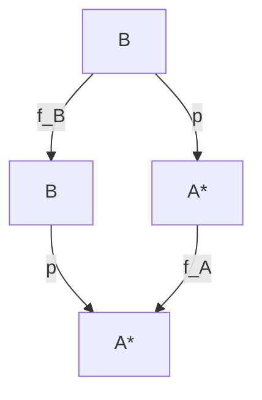

# DR-08 · O_08: двухшаговая проекция

## Найдено

**Внешняя математика позволяет построить строгие локальные инстансы O_08, но не доказывает заявленную проекцию для самих уровней ФТС без дополнительного отображения объектов и семантики.** Равенство `π(M_{n+2})=M_n*` существенно слабее проверяемого сохранения прежнего вопроса. Если `M_n*` определяется самим результатом сжатия, равенство становится определением, а не свидетельством сохранения.

Найдены четыре класса материала:

- **Direct:** Galois insertion даёт ретракцию; вложенные ортогональные проекции дают композиционную согласованность. Это прямые результаты для соответствующих математических объектов, а не подтверждение их отождествления с ФТС.
- **Limiting:** полнота абстрактной интерпретации зависит от направления, множества операций и области входов; strong preservation зависит от языка. Существование оптимального уточнения требует предпосылок.
- **Alternative:** факторизация через quotient, correctness kernels, локальный repair и разложение на приближение плюс детали выполняют разные части функции Expand₂/Compress₂.
- **Refuting:** конечные контрпримеры опровергают переходы «локальные ретракции ⇒ согласованная система» и «forward completeness ⇒ нисходящее сохранение всех операций». Скалярная интерпретация `x↦|x|` теряет знак; восстановить прежний вопрос о знаке невозможно.

Ключевые внешние опоры: [Giacobazzi–Ranzato–Scozzari, 2000](https://doi.org/10.1145/333979.333989), [Ranzato–Tapparo, 2007](https://doi.org/10.1093/logcom/exl035), официальные библиотеки [Galois insertion](https://leanprover-community.github.io/mathlib4_docs/Mathlib/Order/GaloisConnection/Defs.html) и [ортогональной проекции](https://leanprover-community.github.io/mathlib4_docs/Mathlib/Analysis/InnerProductSpace/Projection/Basic.html). Их условия и границы переноса разобраны ниже.

## Зависимости

### 1. Что именно взято из ФТС

Основной локальный источник — приложенный `FTS_research_project_for_AI(3).md`, разделы 3.4, 8.1, 8.1a и таблица операторов. Более ранний `FTS_research_project_for_AI.md` использован для сопоставления формулировок; `FTS_Deep_Research_2026-09-05(1).md` — как контекст предыдущего поиска, не как внешний первоисточник.

Канонические положения сохраняются как объект описания:

1. `Compress₂(M_{n+2})=M_n*`.
2. `Expand₂(M_n,Op_{n+1},Res_n)=M_{n+2}`.
3. В §8.1 перечислены связи `projects_to` через два уровня; для C34 приведены числовые свидетели:
   \[
   U_4=U_2\circ\pi=|x|,\quad U_5=U_3\circ\pi=-|x|,
   \]
   \[
   U_6=U_4\cdot\pi=x^2,\quad U_7=U_5\cdot\pi=-x^2,
   \qquad\pi(x)=|x|.
   \]
4. В §8.1a «малая форма = проекция» вводится через согласование на якорях и исключение зеркальной пары. Это локальное определение ФТС, а не стандартная теорема о ретракциях.
5. М-регистр — минимальное логическое выражение; А-регистр содержит математические аналоги; Ч-регистр — операционные действия. В источнике явно ограничен обратный перенос: `Sem(U_n) ⇒ M_n`, но `M_n ⇏ Sem(U_n)`.

Поэтому скалярный контрпример ниже относится к А-регистру и к предложенному мосту восстановления. Он не опровергает автоматически всю семантику уровня. Также термин «удержание» нижней пары не заменяется буквальным включением множеств. Для такого переноса нужен самостоятельный носитель удерживаемого различия.

Не обнаружено достаточной спецификации типов `M_n*`, общей области допустимых входов Expand₂ и единой семантической эквивалентности между малой и расширенной формами. Это содержательная недоопределённость проверяемого claim, а не недостаток внешней терминологии.

### 2. Разделение утверждений

| Ступень | Проверяемое утверждение | Что из него не следует |
|---|---|---|
| P0 | Существует функция из богатого носителя в малый | Сохранение заранее заданного вопроса |
| P1 | Compress после Expand возвращает нормализованную малую форму | Восстановление всех деталей богатого состояния |
| P2 | Проекция представлений одного исходного объекта совпадает с его старым представлением | Сохранение произвольной операции |
| P3 | Сохраняются все вопросы фиксированного языка Q | Различимость всех состояний, если Q беден |
| P4 | Коммутируют выбранные операции | Коммутирование остальных операций |
| P5 | Все пути между одинаковыми уровнями дают одинаковую проекцию | Существование глобального предела произвольной системы |
| P6 | По малой форме и остаткам восстанавливается богатая форма | Каноничность или вычислимость выбора остатков |

Сдвиг индекса `n→n+2` сам по себе не означает композицию двух отображений через `n+1`. Для такого прочтения необходимо отдельно задать промежуточный уровень и обе стрелки. Две связи O_08 подряд дают маршрут `n+4→n+2→n`, а не автоматически внутреннее устройство одной связи.

### 3. Минимальная спецификация локального инстанса

Ниже — **предлагаемая спецификация**, не новое определение канона.

Пусть A — носитель малых форм, B — носитель расширенных. Если звёздочка означает нормализацию, зададим независимо идемпотентную функцию \(\nu:A\to A\), \(\nu^2=\nu\), и \(A^*=\operatorname{Fix}\nu\). Если нормализация не нужна, берётся \(\nu=\mathrm{id}\). Альтернатива — явное отношение эквивалентности; его нельзя молча заменить равенством.

Для каждого \(a\in A^*\) пусть \(Z_a\) — множество допустимых контекстов, содержащих необходимые `Op` и `Res`. Требуются типизированные функции

\[
p:B\to A^*,\qquad
E:\coprod_{a\in A^*}Z_a\to B,
\]

и закон

\[
\boxed{\forall a\in A^*\;\forall z\in Z_a:\quad p(E(a,z))=a.}\tag{R}
\]

Чтобы расширялась каждая малая форма, необходимо \(Z_a\ne\varnothing\) для каждого a. Выбор \(z(a)\) даёт секцию \(e(a)=E(a,z(a))\), то есть \(pe=\mathrm{id}\). В категории множеств это один вопрос; непрерывность, измеримость, сохранение групповой операции или вычислимость секции — дополнительные условия.

**Сохранение старого представления.** Фиксируются общая область исходных объектов Ω и независимо заданные кодировки \(\eta_A:\Omega\to A\), \(\eta_B:\Omega\to B\). Требуется

\[
\boxed{p\eta_B=\nu\eta_A.}\tag{S}
\]

Без S можно построить ретракцию, которая не восстанавливает прежнее описание того же объекта.

**Сохранение вопроса.** Для заранее выбранных вопросов \(q\in Q\), значений \(V_q\) и, при необходимости, перевода языка j задаются оценки на обоих носителях:

\[
\boxed{\forall b\in B\;\forall q\in Q:\quad
\operatorname{eval}_B(b,jq)=\operatorname{eval}_A(pb,q).}\tag{Q}
\]

Определять левую оценку задним числом через правую допустимо как конструкцию модели, но нельзя выдавать это за независимое подтверждение сохранения старой семантики.

**Сохранение операции.** Для каждой выбранной k-арной операции требуются

\[
\boxed{p\,f_B=f_A\,p^{\times k}.}\tag{O}
\]

Для унарного случая диаграмма имеет вид:



Для частичных операций требуется также согласовать области определённости. Если утверждается сохранение возможности выполнения, одного равенства результатов на общей части области недостаточно.

**Согласованность нескольких уровней.** Для всех допустимых троек \(i\le j\le k\):

\[
p_{i,i}=\mathrm{id},\qquad p_{k,i}=p_{j,i}\circ p_{k,j}.\tag{C}
\]

Равенство только по вопросам Q даёт более слабую Q-согласованность. До равенства функций оно усиливается лишь при разделяющем состояния языке.

**Остатки.** Полное восстановление богатого состояния требует экстрактора \(r(b)\in Z_{pb}\) и отдельного закона

\[
E(pb,r(b))=b.\tag{D}
\]

Закон R не влечёт D. Тем более он не влечёт \(ep=\mathrm{id}_B\): последнее вместе с R уничтожило бы различие между простой ретракцией и изоморфизмом.

### 4. Два необходимых критерия: волокна и конгруэнция

Следующие доказательства — самостоятельный анализ спецификации; им не приписывается научная новизна.

**Критерий восстановления старого представления.** На достижимой части B существует единственная функция p, удовлетворяющая S, тогда и только тогда, когда

\[
\eta_B(\omega)=\eta_B(\omega')
\ \Longrightarrow\ 
\nu\eta_A(\omega)=\nu\eta_A(\omega')
\quad(\forall\omega,\omega'\in\Omega).\tag{F}
\]

Необходимость получается применением p. Для достаточности положим \(p(\eta_B\omega)=\nu\eta_A\omega\); F обеспечивает независимость от представителя. Единственность относится только к \(\operatorname{im}\eta_B\). Продолжение на недостижимые состояния — отдельная задача.

Аналогично вопрос восстанавливается через p ровно тогда, когда его ответ постоянен на каждом волокне p. Это точный мост к условию корректности quotient lift в [Mathlib.Data.Quot](https://leanprover-community.github.io/mathlib4_docs/Mathlib/Data/Quot.html).

**Критерий переноса операции.** Операция на B спускается на образ p тогда и только тогда, когда

\[
(\forall i\;p b_i=p b_i')\Longrightarrow
p f_B(b_1,\ldots,b_k)=p f_B(b_1',\ldots,b_k').
\]

После этого необходимо ещё проверить, что полученная операция совпадает с ранее заданной \(f_A\). Само существование некоторой индуцированной операции не доказывает сохранение конкретной старой операции.

### 5. Что действительно следует из Galois insertion и полноты

Для порядков C и A Galois connection означает

\[
\alpha(c)\le_A a\iff c\le_C\gamma(a).
\]

В Galois insertion дополнительно \(\alpha\gamma=\mathrm{id}_A\). Это даёт R при \(p=\alpha,e=\gamma\). Обычная connection этого не гарантирует. Кроме того, в абстрактной интерпретации \(\gamma(a)\) обычно является конкретным **семантическим элементом**, например множеством состояний, а не выбранным исходным состоянием. [Официальные определения и теоремы Mathlib](https://leanprover-community.github.io/mathlib4_docs/Mathlib/Order/GaloisConnection/Defs.html).

Для наиболее прозрачного локального построения возьмём общую полную решётку C и операторы замыкания \(\rho_B\le\rho_A\). Тогда

\[
A=\operatorname{Fix}\rho_A\subseteq B=\operatorname{Fix}\rho_B,
\quad p=\rho_A|_B,\quad e:A\hookrightarrow B.
\]

Из свойств замыкания непосредственно следует

\[
\rho_A\rho_B=\rho_A,\qquad pe=\mathrm{id}_A.
\]

Для вложенной цепочки таких замыканий композиционная согласованность получается автоматически. Это собственный вывод из заданной конструкции; он не относится к произвольно выбранным стрелкам между уровнями.

Пусть F — конкретная операция, а лучшие корректные абстрактные операции заданы как

\[
f_B=\rho_BF|_B,\qquad f_A=\rho_AF|_A.
\]

Тогда при \(b\in B\)

\[
pf_B(b)=\rho_AF(b),\qquad
f_Ap(b)=\rho_AF\rho_A(b).
\]

Следовательно, нисходящая диаграмма O выполняется ровно при равенстве этих выражений на B. **Backward completeness** старого замыкания на всей C достаточна; при B=C она необходима. Напротив, **forward completeness** утверждает сохранение образа конкретной операции внутри абстрактного носителя и обеспечивает другую, восходящую диаграмму. Различение направлений соответствует [Ranzato–Tapparo, §2.2.2](https://arxiv.org/html/cs/0401016v3).

Глобальная completeness, локальная completeness в одном входе и точность только для заданных формул — разные кванторы. Ни один из них не предоставляет автоматически индексный сдвиг на два, алгоритм Expand₂ или остатки D.

### 6. Следует ли спецификация из strong preservation?

В формализме Ranzato–Tapparo strong preservation задаётся относительно конкретного языка L и абстракции:

\[
\forall\varphi\in L\;\forall S\subseteq\Sigma:\quad
\alpha(S)\le\llbracket\varphi\rrbracket_A
\iff S\subseteq\llbracket\varphi\rrbracket_C.
\]

Эквивалентная форма — точность конкретизации денотатов формул. Forward completeness для атомов и операций достаточна для SP; обратное в общем случае неверно. Для языка, содержащего атомы всех исходных абстрактных элементов и произвольные конъюнкции, теорема 6.7 связывает абстракцию языка с forward complete shell. Это специальные условия, а не безусловная эквивалентность. [Определение 5.2, леммы 5.3 и 6.5, пример 6.6, теорема 6.7](https://www.math.unipd.it/~ranzato/papers/jlc07.pdf).

Наш вывод для O_08: если обе абстракции A и B сохраняют один и тот же фиксированный язык и \(p=\alpha_A\gamma_B\), то для каждой формулы

\[
p\llbracket\varphi\rrbracket_B
=\alpha_A\llbracket\varphi\rrbracket_C
=\llbracket\varphi\rrbracket_A.
\]

Последнее равенство использует insertion и точность денотата A. Получено сохранение **денотатов этого языка**. Отсюда не следуют R для произвольной пары носителей, O для недефинируемых входов, C для независимо выбранных проекций или D для богатых состояний. При слишком бедном языке SP совместима с различными, неравными проекциями.

### 7. Положительный конечный инстанс и контрпримеры

#### W1. Полностью проверяемый локальный инстанс

Пусть \(A=\{0,1\}\), \(B=\{0,1\}^2\), \(p(a,r)=a\), \(E(a,r)=(a,r)\). Старый вопрос — любая булева функция a; новый вопрос может читать r. Зададим

\[
f_A(a)=1-a,\qquad f_B(a,r)=(1-a,r\mathbin{\mathrm{xor}}a).
\]

Выполняются R, Q, O и D с остатком второй координаты. Богатство нетривиально: \((a,0)\ne(a,1)\), их старые проекции равны, а новый вопрос различает их. Добавление третьей координаты с согласованными забывающими отображениями даёт C. Это `supports_local_instance`: модель функции O_08 существует, но её биты не идентифицированы с каноническими уровнями ФТС.

#### W2. Локальные ретракции не обеспечивают композицию

Возьмём A из одного бита, B из двух, C из трёх и

\[
p_{B,A}(a,b)=a,\quad p_{C,B}(a,b,c)=(a,b),\quad
r_{C,A}(a,b,c)=a\mathbin{\mathrm{xor}}c.
\]

Все три отображения сюръективны и имеют секции, получаемые добавлением нулей. Однако на \((0,0,1)\) двухшаговый маршрут даёт 0, прямая стрелка — 1. Несогласованность возникает на четырёх из восьми входов. Это **не** контрпример к теореме об обратной системе: такая семья ещё не является обратной системой по определению. Это контрпример к выведению согласованности из существования локальных проекций.

Язык из одних констант «истина» и «ложь» сохраняется всеми этими отображениями. Следовательно, сохранение бедного языка не обеспечивает равенства стрелок.

#### W3. Числовые свидетели ФТС: что сохраняется

На \(\Omega=\mathbb R\) положим \(\eta_2(x)=x\), \(\eta_4(x)=|x|\), \(\eta_6(x)=x^2\).

Проекция \(p_{6,4}(t)=\sqrt t\) на \([0,\infty)\) корректно восстанавливает \(|x|\). Но функции \(p_{4,2}\), восстанавливающей x на всей \(\mathbb R\), не существует: входы +1 и −1 дают одно значение \(\eta_4\), но разные \(\eta_2\). Нарушен критерий F.

Исправления возможны, но меняют точный claim: ограничить область \(x\ge0\), восстанавливать только модуль или сохранить знак в остатке. Если носителем является граф \((x,F(x))\), x уже сохранён; это другой носитель, а не опровержение скалярного контрпримера.

На скалярных образах \(|x|\) и \(x^2\) взаимно однозначно определяют друг друга. Поэтому эта пара сама по себе не доказывает прирост информации. Она также не доказывает тождество уровней ФТС в остальных регистрах.

В C34 композиция и поточечное произведение выполняют разные функции:

\[
\pi\circ\pi=|x|,\qquad \pi\cdot\pi=x^2.
\]

При x=2 значения равны 2 и 4. Верность обоих канонических равенств не превращает их в единую композиционную схему проекций.

Наконец, совпадение на двух якорях не доказывает равенства функций на всей области. Например, f(x)=x и g(x)=x+x(x−1) совпадают в 0 и 1, но различаются в 2. Для двух якорей нужен дополнительный класс идентифицируемости, например аффинные функции. Авторское определение «проекции» через якоря сохраняется; семантическое следствие из него ограничивается.

#### W4. Два направления полноты независимы

Пусть \(C=\{0<1<2\}\), \(A=\{0,2\}\), \(\rho=(0,2,2)\). Включение A в C с ρ образует insertion.

Монотонная \(F=(0,0,2)\) сохраняет A и forward complete. Но при входе 1

\[
\rho F(1)=0\ne2=\rho F\rho(1).
\]

Нисходящая диаграмма нарушена. Монотонная \(G=(1,2,2)\), напротив, backward complete: обе стороны \(\rho G=\rho G\rho\) постоянно равны 2. Однако G(0)=1 не принадлежит A, поэтому forward completeness отсутствует. Это самостоятельные конечные свидетели, согласующиеся с разграничением в первоисточнике.

Обычная Galois connection также не равна insertion: C состоит из одного элемента, A — цепочка 0<1, α посылает единственный элемент в 0, γ — оба элемента обратно. Adjunction выполнена, но \(\alpha\gamma(1)=0\ne1\).

#### W5. Quotient не гарантирует структурную секцию

Сюръективный гомоморфизм \(q:\mathbb Z\to\mathbb Z/2\mathbb Z\) не имеет гомоморфной секции. Иначе \(2s(\bar1)=s(\bar0)=0\), откуда \(s(\bar1)=0\) в ℤ, вопреки \(qs(\bar1)=\bar1\). Секция как функция множеств существует. Поэтому категория допустимых Expand принципиальна.

#### W6. Multiresolution: точное сжатие и предел сохранения операций

Самостоятельный конечный пример в \(\mathbb R^4\):

\[
V_0=\{(a,a,a,a)\}\subset V_1=\{(a,a,b,b)\}\subset V_2=\mathbb R^4.
\]

Пусть \(P_i\) — ортогональные проекции. Тогда \(P_0\) усредняет четыре координаты, \(P_1\) усредняет пары. Выполняются \(P_0P_1=P_0=P_1P_0\) и

\[
x=P_0x+(P_1-P_0)x+(I-P_1)x.
\]

Expand складывает старое приближение и две детали; Compress применяет \(P_0\). Все линейные вопросы \(\langle x,h\rangle\) при \(h\in V_0\) сохраняются. Общая теорема о вложенных подпространствах формализована в [Mathlib, Projection.Basic](https://leanprover-community.github.io/mathlib4_docs/Mathlib/Analysis/InnerProductSpace/Projection/Basic.html).

Но покоординатное возведение в квадрат не коммутирует со сжатием: для \(x=(1,-1,1,-1)\)

\[
P_0(x^2)=(1,1,1,1),\qquad (P_0x)^2=0.
\]

Без вложенности даже ортогональные проекции могут не коммутировать: проекция на первую ось и на диагональ в \(\mathbb R^2\) дают разные композиции. Следовательно, слово multiresolution не заменяет проверку вложенности и выбранного класса операций.

#### W7. Глобальная совместимость сильнее локальной

Пусть S несчётно, индексы — конечные подмножества \(F\subset S\), \(X_F=\operatorname{Inj}(F,\mathbb N)\), стрелки — ограничения. Все \(X_F\) непусты; каждую конечную инъекцию можно продолжить на большее конечное множество, поэтому стрелки сюръективны. Они согласованы. Элемент обратного предела дал бы инъекцию \(S\to\mathbb N\), что невозможно.

Это самостоятельный прозрачный свидетель глобального препятствия. Аналогичный класс результатов представлен у [Deo–Awasthi, §§3–4](https://arxiv.org/html/0908.2168v1). Для счётного направленного индекса непустые системы с условием Mittag–Leffler имеют непустой предел; сюръективность обеспечивает это условие. [Stacks, лемма 10.86.3](https://stacks.math.columbia.edu/tag/0594). Несчётный пример не опровергает конечную или обычную счётную башню ФТС.

## Вывод

| Проверяемый тезис | Решение |
|---|---|
| Возможен строгий локальный O_08 | Да: W1 и W6 дают явные реализации при указанных носителях |
| Из существования функции π следует сохранение нижнего слоя | Нет: нужны S/Q и критерий волокон |
| Galois insertion обеспечивает возврат малой формы | Да, в её собственных типах; это R, не вся спецификация |
| Уточнение абстрактного домена автоматически сохраняет операции | Нет: нужна соответствующая completeness или отдельная проверка O |
| Strong preservation доказывает весь O_08 | Нет: оно обеспечивает точность фиксированного языка при заданном мосте |
| Локальные проекции автоматически образуют обратную систему | Нет: W2; C необходимо проверять или обеспечивать конструкцией |
| Числовые свидетели C34 доказывают восстановление x из \(|x|\) | Нет на всей ℝ; да для ограниченного вопроса/области/дополненного носителя |
| Два якоря доказывают семантическую проекцию | Нет без ограничений на класс моделей |
| Внешняя литература обосновывает именно сдвиг n+2 для ФТС | Не установлено |

**Итоговый статус claim: `insufficient_evidence` для общего утверждения о канонических уровнях ФТС; `supports_local_instance` для явно построенных моделей; `limits` для перехода от них к ФТС.** Производное утверждение о восстановлении знакового скаляра из модуля в той же области имеет статус `contradicts_same_domain`. Это не повышение и не понижение статуса всей ФТС: предмет решения — конкретный мост и его кванторы.

## Что не закрыто

1. Независимое определение \(M_n^*\): нормальная форма, quotient, эквивалентность по вопросам или нечто другое.
2. Типы носителей и отображений для каждой заявленной пары уровней; нельзя переносить скалярную стрелку на логический или операционный регистр без нового отображения.
3. Фиксированный язык Q и операции, которые должны сохраняться. Неясно, требуется ли сохранение знака, порядка, выполнения действий, результата или только якорных оценок.
4. Допустимые `Op` и `Res`, их извлечение из расширенной формы и доказательство R/D. Простая запись Expand не устанавливает существования этих данных.
5. Согласованность независимых маршрутов и точность либо эквивалентность, с которой понимаются диаграммы.
6. Универсальные доказательства для канонических уровней, особенно за пределами явно выписанных числовых свидетелей. Успешные конечные примеры не дают индукции по n.
7. Вычислимость, сложность и завершение процедур уточнения. Существование complete shell не означает построения за два шага.
8. Полные тексты двух классических работ Mallat в этой сессии не получены; решающие утверждения о проекциях проверены по официальной формальной библиотеке и собственному конечному примеру.
9. Проверка исправлений ограничена доступными метаданными, страницами версий и поиском уведомлений. Отсутствие найденного уведомления не является сертификатом отсутствия ретракции во всех базах.

Заявление о мировой новизне не делается. Отсутствие найденного точного аналога ФТС не является положительным доказательством новизны.

## Evidence matrix

`direct` здесь означает совпадение математического предиката при явно указанном отображении. Это не означает, что соответствие внешних объектов реальным уровням ФТС уже доказано. `strongest counterevidence` приведено как наиболее сильное найденное ограничение результата или его переноса; действующая теорема с выполненными предпосылками не объявляется опровергнутой.

| ID | Точный внешний результат, область и кванторы | Локатор | Мост к O_08 и граница | relation | verdict |
|---|---|---|---|---|---|
| E01 | Для Galois insertion между порядками \(\forall a\;\alpha\gamma(a)=a\); α сюръективна | S3, `GaloisInsertion.l_u_eq`, `leftInverse_l_u`, `l_surjective` | p=α, E=γ; гарантирует R. Конкретизация может быть множеством состояний, а не состоянием ФТС | direct | supports_local_instance |
| E02 | Quotient lift существует для функции, постоянной на эквивалентных представителях; lift после quotient map равен исходной функции | S4, `Quotient.lift_comp_mk`, предпосылка lift | Вопрос проходит через сжатие при постоянстве на волокнах. Секция и перенос операций отдельно | alternative | independent_alternative |
| E03 | Обратная система содержит тождества и закон композиции для всех сравнимых троек индексов | S5, определение 4.21.2 | C является входным требованием. Из отдельных π оно не выводится | limiting | limits |
| E04 | Для счётного направленного индекса непустая Mittag–Leffler система множеств имеет непустой предел; сюръективные стрелки достаточны для ML | S6, пример 10.86.2, лемма 10.86.3 | Обеспечивает глобальное совместимое семейство при этих условиях; не даёт фиксированного Expand и семантики | limiting | limits |
| E05 | Для \(U\le V\) с ортогональными проекциями \(P_UP_V=P_U\); \(P_Uu=u\) при \(u\in U\) | S7, `starProjection_comp_starProjection_of_le`, `starProjection_mem_subspace_eq_self` | Coarse/fine=вложенные подпространства; прямое выполнение R/C. Нелинейные операции не сохраняются автоматически | direct | supports_local_instance |
| E06 | Backward completeness: \(\alpha f=f^\#\alpha\); для лучшей абстракции \(\rho f=\rho f\rho\). Complete shells требуют условий существования | S1, §3, рукописные PDF с.12–14; теоремы 5.3, 5.10, с.25,27; пример 5.6, с.26 | Даёт нисходящую точность выбранных операций; монотонности одной недостаточно для всех shell-конструкций | limiting | limits |
| E07 | SP — точность всех формул заданного языка; достаточность forward completeness и неэквивалентность без дополнительных условий | S2, определение 5.2, леммы 5.3,6.5, пример 6.6, теорема 6.7 | Q для денотатов. Не обеспечивает O на всех абстрактных аргументах или C независимых стрелок | limiting | limits |
| E08 | Correctness kernel — наиболее грубая абстракция с теми же лучшими корректными аппроксимациями операций; существование при непрерывности \(f\rho_A\) для каждого f | S8, определение 2.1, теорема 3.3, пример 3.5 | Альтернативное сжатие анализа. Сохраняется аппроксимация, которая может быть неточной относительно конкретной семантики | alternative | independent_alternative |
| E09 | Локальная полнота в c: \(\rho f(c)=\rho f\rho(c)\); pointed shell имеет специальные критерии существования | S9, §4, теоремы 4.9 и 4.11, журнальные с.433 | Подходит проверке выбранного входа/ветвления. Не распространяется автоматически на все c и все вопросы | alternative | independent_alternative |
| E10 | Refinement и compressor действуют на доменах; оптимальный compressor определён не для любого refinement, adjunction требует специально заданного порядка | S11, определения 3.1 и 4.1; §4; теорема 5.2 | Функциональный аналог управления выразительностью, но иной уровень объектов, чем элементы \(M_n\) | alternative | independent_alternative |
| E11 | Существует согласованная система непустых множеств с сюръективными стрелками и пустым пределом на несчётном индексе | S10, §§3–4 | Опровергает неограниченный переход от локальной реализуемости к глобальной. Не относится автоматически к счётным уровням ФТС | refuting | contradicts_same_domain |
| E12 | Три конечные split surjection могут нарушать композиционное равенство | W2, явный свидетель (0,0,1) | Опровергает P1⇒P5 в той же категории множеств | refuting | contradicts_same_domain |
| E13 | Модуль не определяет знаковый исходный скаляр на ℝ | W3, ±1; критерий F | Опровергает скалярный мост восстановления U2 из U4; другие регистры не охвачены | refuting | contradicts_same_domain |
| E14 | Forward completeness не влечёт backward completeness и наоборот | W4, конечная цепочка; внешний ориентир S2 §2.2.2 | Опровергает смешение двух commuting diagrams в одной области абстрактной интерпретации | refuting | contradicts_same_domain |
| E15 | Сюръективный гомоморфизм может не иметь гомоморфной секции | W5 | Ограничивает структурный Expand; не мешает существованию секции множеств | refuting | contradicts_same_domain |
| E16 | Совпадение на двух точках не определяет общую функцию | W3, f и g | Ограничивает семантическое следствие из якорного определения ФТС, не отменяя самого определения | refuting | limits |

### Уточнения предпосылок для конструкций refinement

- **E06:** теоремы S1 5.3 и 5.10 используются для семейств непрерывных семантических функций на полных решётках; непрерывность здесь означает сохранение соответствующих направленных супремумов, а не топологическую непрерывность числовой формулы. Пример 5.6 запрещает заменять это условие одной монотонностью.
- **E08:** сравниваются замыкания на одной C и одно фиксированное семейство F. Равенство поведения записывается как \(\rho_A f\rho_A=\rho_B f\rho_B\) для каждого f. Теорема 3.3 предполагает непрерывность \(f\rho_A\), а не просто наличие отображления между носителями.
- **E09:** C — полная решётка, A — абстрактный домен, c — фиксированный вход. В теореме 4.9 для \(u=\bigvee L^A_{c,f}\), где L — множество допустимых точек локального уточнения, при монотонном f полнота уточнения \(A_u\) эквивалентна тому, что оно является pointed shell. При аддитивном f критерий имеет вид \(f(c)\le u\Rightarrow f(u)\le u\). Для двух комплементарных булевых фильтров теорема 4.11 строит точку \(u=(A(P\cap b)\cap b)\cup(A(P\cap\neg b)\cap\neg b)\). Квантор относится к заданному P, а не ко всем входам после одного исправления.
- **E10:** теорема 5.2 требует идемпотентного n-арного refinement, обратимости по выбранной координате на указанном подмножестве, замкнутости индуцированного унарного refinement на полной подрешётке и специально изменённого порядка, зависящего от refinement. Она не утверждает adjunction в исходном порядке точности для произвольной пары операций с названиями Expand и Compress.

### Сильнейшие ограничения и альтернативные объяснения по результатам

| ID | strongest counterevidence / ограничение | Альтернативное объяснение наблюдаемого успеха |
|---|---|---|
| E01 | W4: обычная connection не insertion; W5: секция нужной структуры может отсутствовать | Возврат обеспечен устройством абстракции, а не универсальным законом расширения |
| E02 | W3: вопрос о знаке не постоянен на волокне модуля | Сжатие сохраняет только инварианты выбранной эквивалентности |
| E03 | W2: все локальные ретракции существуют, но прямой путь отличается | Согласованность обеспечивается выбором стрелок как композиций |
| E04 | E11/W7 при несчётном индексе | Успех счётного построения объясняется ML и условиями выбора, а не одним наличием стрелок |
| E05 | W6: квадрат не коммутирует с усреднением; невложенные проекции не коммутируют | Сохраняются координаты старого подпространства и соответствующие линейные вопросы |
| E06 | S1, пример 5.6: без условий непрерывности требуемая shell может отсутствовать | Точность относится к выбранным операциям и порядку абстракций |
| E07 | S2, пример 6.6: SP совместима с отсутствием forward completeness | Язык не способен выразить аргументы, на которых обнаруживается потеря точности |
| E08 | S8, пример 3.5: гипотезу непрерывности нельзя просто убрать | Совпадение результатов двух анализов может означать сохранение одной и той же ошибки аппроксимации |
| E09 | S9, §4: общая локальная задача не обязана иметь наименьшее уточнение | Исправлен конкретный вход или проверяемое ветвление, а не весь домен |
| E10 | Не всякий refinement допускает compressor; теорема 5.2 использует специальный порядок | Названия описывают преобразование абстрактных доменов, а не реконструкцию прежнего состояния |
| E11 | Счётная ML-теорема E04 ограничивает применимость отрицательного результата | Пустота возникает из глобальной мощности/совместимости, а не из нарушения локальных стрелок |
| E12 | Если прямую стрелку определить композицией, контрпример исчезает | Наблюдаемая согласованность может быть заложена определением |
| E13 | Ограничение x≥0 или остаток знака восстанавливает факторизацию | Потерянный вопрос исключён из области либо сохранён в другом компоненте |
| E14 | На ограниченном наборе входов обе формулы могут случайно совпасть | Успех отдельных примеров не различает направления полноты |
| E15 | Секция множеств существует | Expand может использовать выбор представителей, не сохраняя алгебру |
| E16 | Для аффинных функций двух разных точек достаточно | Якорные тесты могут работать в неявно ограниченном семействе, которое ещё нужно задать |

Ни одна из строк E01–E11 не использована как безусловное подтверждение ФТС. Работы только с совпадающими словами без описанного моста имеют статус `analogy / nonconfirmation` и вынесены из решающего набора.

## Записи для EXTERNAL_CONFLICTS

Это предлагаемые новые записи; исходные файлы ФТС не изменялись. Часть конфликтов относится к проверяемому **производному мосту**, а не к утверждению, будто канон уже содержит соответствующую внешнюю теорему.

### EC-O08-01 · Якорная проекция и восстановление вопроса

- **Сторона ФТС:** §8.1a основного файла определяет малую форму через якорное согласование; §8.1 использует x и |x| как числовые свидетели.
- **Внешняя сторона:** quotient lift требует постоянства функции на классах; S4, `Quotient.lift_comp_mk` и условие lift. Критерий F выше даёт точную форму для кодировок.
- **Область/регистр:** А-регистр, скалярная область ℝ, вопрос «каково исходное x/его знак?».
- **Мост:** \(\eta_A(x)=x,\eta_B(x)=|x|\), требование \(p\eta_B=\eta_A\).
- **Свидетель:** +1 и −1; одинаковая расширенная запись, разные старые ответы.
- **Решение:** `contradicts_same_domain` для этого скалярного восстановления; `limits` для якорного критерия. Сохранить авторское определение, ограничить семантическое следствие либо дополнить носитель знаком.
- **Незакрытый остаток:** носители М-/Ч-регистра и семантика `M_n*`.

### EC-O08-02 · Конструкция функции и проекция представления

- **Сторона ФТС:** C34, §8.1: композиция с |x| и поточечное произведение с |x|.
- **Проверяемый мост:** трактовать обе операции как один и тот же композиционный механизм нисходящей π.
- **Внешняя сторона:** S5, определение 4.21.2, требует типизированных стрелок и композиционного закона.
- **Область/регистр:** функции ℝ→ℝ в А-регистре.
- **Свидетель:** \((\pi\circ\pi)(2)=2\), \((\pi\cdot\pi)(2)=4\).
- **Решение:** `nonconfirmation` для такого отождествления. Канонические равенства верны как разные конструкции; отдельно задать восстанавливающие стрелки на образах, например √ для x²→|x|.
- **Незакрытый остаток:** связь конструкций C34 с логическими уровнями и общая композиционная спецификация.

### EC-O08-03 · Локальные секции и согласованность

- **Сторона проверяемого claim:** из существования Expand₂/Compress₂ для каждой пары выводится согласованность всех путей.
- **Внешняя сторона:** S5, определение 4.21.2; W2.
- **Область/регистр:** абстрактные представления как конечные множества, без отождествления с конкретным регистром ФТС.
- **Мост:** Expand — секция каждой локальной π.
- **Свидетель:** три битовые стрелки W2 и вход (0,0,1).
- **Решение:** `contradicts_same_domain` для импликации; включить C в локальную спецификацию или конструировать стрелки из общей цепочки замыканий.
- **Незакрытый остаток:** отсутствует список реально заданных альтернативных маршрутов ФТС.

### EC-O08-04 · Strong preservation и весь O_08

- **Сторона проверяемого внешнего моста:** strong preservation или forward completeness объявляется достаточной для любого нисходящего сохранения.
- **Внешняя сторона:** S2, §2.2.2, лемма 6.5, пример 6.6, теорема 6.7.
- **Область/регистр:** семантические решётки и фиксированный язык; перенос к М-регистру ещё не построен.
- **Мост:** p=α, богатая операция конкретная, малая — лучшая корректная абстракция.
- **Свидетель:** W4, forward complete F с нарушением нисходящей диаграммы в 1; для SP — ограниченный язык примера 6.6.
- **Решение:** `limits`; указать направление полноты, язык, атомы, замкнутость под конъюнкциями и множество аргументов. Не приписывать эту чрезмерную импликацию самому канону, который уже оговаривает границу переноса.
- **Незакрытый остаток:** конкретный язык ФТС и его денотационная семантика.

### EC-O08-05 · Проекция и структурный Expand

- **Сторона проверяемого моста:** всякая сюръективная π допускает Expand, сохраняющий нужные операции.
- **Внешняя сторона:** различие quotient lift (S4) и section; доказательство W5.
- **Область/регистр:** категория групп как проверочная область, не буквальная модель уровней ФТС.
- **Мост:** π — гомоморфизм, Expand должен быть гомоморфной секцией.
- **Свидетель:** ℤ→ℤ/2ℤ.
- **Решение:** `contradicts_same_domain` для общего структурного утверждения; выбрать категорию и доказать свойства секции отдельно.
- **Незакрытый остаток:** требуется ли от Expand₂ сохранение операций или только выбор представителя с контекстом.

### EC-O08-06 · Локальная реализуемость и глобальный предел

- **Сторона проверяемого моста:** произвольная согласованная семья локальных сюръекций гарантирует глобальную расширенную форму.
- **Внешняя сторона:** S10, §§3–4; S6, лемма 10.86.3.
- **Область/регистр:** системы множеств с произвольным направленным индексом.
- **Мост:** глобальное состояние — совместимое семейство всех локальных состояний.
- **Свидетель:** W7, конечные частичные инъекции несчётного S в ℕ.
- **Решение:** `contradicts_same_domain` для неограниченной импликации; для счётной ML-системы действует положительный результат. Не применять несчётный контрпример к конечной башне ФТС.
- **Незакрытый остаток:** требуется ли вообще глобальный предел в O_08; локальный claim его не утверждает.

## Включённые источники и проверка записей

Для статей различаются год журнала, год онлайн-публикации и версия препринта. Номера страниц авторской рукописи не выдаются за журнальные. Проверка существования выполнена по первичным текстам и издательским/DOI-записям; состояние исправлений описано с ограничениями.

| ID | Проверенная библиографическая запись и доступ к первоисточнику | Проверка версии, исправлений и ретракций |
|---|---|---|
| S1 | Roberto Giacobazzi, Francesco Ranzato, Francesca Scozzari. **Making abstract interpretations complete.** *Journal of the ACM* 47(2), 361–416, 2000. [DOI 10.1145/333979.333989](https://doi.org/10.1145/333979.333989). [Авторский полный PDF](https://www.math.unipd.it/~ranzato/papers/jacm00.pdf) | Crossref: авторы, название, том, страницы, март 2000. Авторская версия 55 PDF-страниц; ключевые места проверены по изображениям после OCR. Уведомлений не найдено в доступных метаданных и целевом поиске; ACM landing недоступен |
| S2 | Francesco Ranzato, Francesco Tapparo. **Generalized Strong Preservation by Abstract Interpretation.** *Journal of Logic and Computation* 17(1), 157–197, 2007; онлайн 2006. [DOI 10.1093/logcom/exl035](https://doi.org/10.1093/logcom/exl035). [arXiv cs/0401016](https://arxiv.org/abs/cs/0401016), [v3](https://arxiv.org/html/cs/0401016v3), [авторский PDF](https://www.math.unipd.it/~ranzato/papers/jlc07.pdf) | v1 2004, v3 14.03.2006; это история редакций, не обозначенная ретракция. Название/авторы/страницы сверены Crossref; ключевые номера сверены в тексте. Уведомлений не найдено; OUP landing недоступен |
| S3 | Mathlib contributors; заголовок исходника: Johannes Hölzl, 2017. **Mathlib.Order.GaloisConnection.Defs.** [Документация](https://leanprover-community.github.io/mathlib4_docs/Mathlib/Order/GaloisConnection/Defs.html), [исходник 9a1338a…](https://github.com/leanprover-community/mathlib4/blob/9a1338a6a1a8eb784150b180bee61950c418eca9/Mathlib/Order/GaloisConnection/Defs.lean) | Официальная формальная библиотека, без DOI. Зафиксирован конкретный снимок; год заголовка не означает год последнего обновления. Полная локальная компиляция Lean не выполнялась |
| S4 | Mathlib contributors; заголовок: Johannes Hölzl, 2017. **Mathlib.Data.Quot.** [Документация](https://leanprover-community.github.io/mathlib4_docs/Mathlib/Data/Quot.html), [исходник 110cb7f…](https://github.com/leanprover-community/mathlib4/blob/110cb7f03dd1c2d9edd957b937f55175c9fc3343/Mathlib/Data/Quot.lean) | Проверены формальные условия lift. История кода заменяет журнальную проверку erratum; никакой проверки всей ФТС в Lean не заявляется |
| S5 | The Stacks Project Authors. **Categories, §4.21 Limits and colimits**, определение 4.21.2. [Tag 0030](https://stacks.math.columbia.edu/tag/0030), [полный раздел](https://stacks.math.columbia.edu/tag/002Z) | Живой коллективный математический справочник; использована версия, доступная 10.09.2026. Это не компьютерно проверенная библиотека. Tag 0031 определяет направленность, а не закон композиции |
| S6 | The Stacks Project Authors. **Algebra, §10.86 Mittag-Leffler systems.** [Tag 0594](https://stacks.math.columbia.edu/tag/0594) | В обсуждении зафиксирована правка формулировки «decreasing family» к «decreasing directed family», подтверждённая автором 31.01.2018. Используется текущая исправленная страница; ретракция результата не обнаружена |
| S7 | Mathlib contributors; заголовок: Zhouhang Zhou, Frédéric Dupuis, Heather Macbeth, 2019. **Mathlib.Analysis.InnerProductSpace.Projection.Basic.** [Документация](https://leanprover-community.github.io/mathlib4_docs/Mathlib/Analysis/InnerProductSpace/Projection/Basic.html), [исходник 01c8d16…](https://github.com/leanprover-community/mathlib4/blob/01c8d16a8c31eed40a54a38a8c8006c4ee001152/Mathlib/Analysis/InnerProductSpace/Projection/Basic.lean) | Проверены актуальные имена `starProjection`; старые имена имеют deprecation 2026 года. Снимки S3/S4/S7 различны: единая совместно собранная версия не заявляется |
| S8 | Roberto Giacobazzi, Francesco Ranzato. **Correctness kernels of abstract interpretations.** *Information and Computation* 237, 187–203, 2014. [DOI 10.1016/j.ic.2014.02.003](https://doi.org/10.1016/j.ic.2014.02.003), [arXiv 0910.4748](https://arxiv.org/abs/0910.4748), [полный v3](https://arxiv.org/html/0910.4748v3) | Препринт 2009, v3 19.04.2013, журнал 2014. Crossref сверён. В доступной записи и целевом поиске исправлений/ретракций не найдено |
| S9 | Roberto Bruni, Roberto Giacobazzi, Roberta Gori, Francesco Ranzato. **Abstract Interpretation Repair.** *PLDI 2022*, 426–441. [DOI 10.1145/3519939.3523453](https://doi.org/10.1145/3519939.3523453), [полный опубликованный PDF у автора](https://www.math.unipd.it/~ranzato/papers/pldi22.pdf) | Название, все авторы, год, страницы сверены Crossref и текстом. Уведомлений не найдено в доступной записи и поиске |
| S10 | Satya Deo, Veerendra Vikram Awasthi. **An Inverse System of Nonempty Objects with Empty Limit.** arXiv:0908.2168, 2009. [Запись](https://arxiv.org/abs/0908.2168), [полный v1](https://arxiv.org/html/0908.2168v1) | v1 15.08.2009. Журнальная публикация не подтверждена; статус препринта явно понижает вес. Проверен результат для множеств; широкое вводное распространение на иные категории не используется. Поздние версии/уведомления не найдены на доступной записи |
| S11 | Roberto Giacobazzi, Francesco Ranzato. **Refining and Compressing Abstract Domains.** *ICALP 1997*, LNCS 1256, 771–781. [DOI 10.1007/3-540-63165-8_230](https://doi.org/10.1007/3-540-63165-8_230), [полный авторский PDF](https://www.math.unipd.it/~ranzato/papers/icalp97.pdf) | Сверены Crossref и первичный текст. Теорема 5.2 не переносится на обычный порядок без её условий. В доступных данных уведомлений не найдено |

Отсутствие `update-to`, `updated-by` и связей исправления в полученной Crossref-записи — отрицательный результат конкретной проверки, а не доказательство, что исправлений никогда не было. Сплошной аудит всех независимых реестров ретракций не проводился.

### Исключённые из решающего доказательства источники

| Источник | Что проверено | Причина исключения и статус |
|---|---|---|
| Stéphane G. Mallat. **A theory for multiresolution signal decomposition: the wavelet representation.** *IEEE TPAMI* 11(7), 674–693, 1989. [DOI 10.1109/34.192463](https://doi.org/10.1109/34.192463) | Библиографическая запись Crossref/OpenAlex; научный поиск | Полный первичный текст не получен: доступы дали отказ/ошибку. Номера теорем не приписываются. `insufficient_evidence` для использования именно этого текста |
| Stéphane G. Mallat. **Multiresolution approximations and wavelet orthonormal bases of L²(R).** *Transactions AMS* 315(1), 69–87, 1989. [DOI 10.1090/S0002-9947-1989-1008470-5](https://doi.org/10.1090/S0002-9947-1989-1008470-5) | DOI-метаданные | Полный текст AMS недоступен. Ветка multiresolution закрыта S7 и W6, но не выдаётся за чтение этой статьи |
| Francesco Ranzato, Francesco Tapparo. **Generalizing the Paige–Tarjan algorithm by abstract interpretation.** *Information and Computation* 206(5), 620–651, 2008. [DOI 10.1016/j.ic.2008.01.001](https://doi.org/10.1016/j.ic.2008.01.001) | Метаданные и аннотация; найдено в forward search | Полный текст не использован; не добавляет проверенного основания сверх S2 |
| Amato–Scozzari, **Observational Completeness on Abstract Interpretation**, DOI 10.3233/FI-2011-381 | Найдено через цитирования | Расхождение индексного года и DOI-версии не разрешено; не включено в доказательство |
| Henkin, **A problem on inverse mapping systems** (1950); Waterhouse, **An empty inverse limit** (1972); Dimitrić, **A Note on Surjective Inverse Systems** (2007); Higman–Stone, **On Inverse Systems with Trivial Limits** (1954) | Навигационные записи/ссылки | Первичные тексты не проверены достаточно для решающих локаторов; результаты не приписываются по пересказам |
| Обзоры abstract interpretation, включая персональную перспективу Monniaux | Навигация | Обзор не заменяет S1/S2/S8/S9 |
| Индексные дубликаты с искажёнными названиями/авторами, включая «Making Abstract Interpretations CompleteRoberto» | Обнаружены при поиске | Не самостоятельные публикации; исключены как ненадёжные метаданные |
| Приложенные тексты Blackwell, identity types/WFS, Dollco, Markov categories, generalization error | Установлена тематическая направленность корпуса | Не использованы как подтверждение O_08: в этом отчёте не построен точный мост их объектов и операций к двухшаговой проекции. Статус возможной словесной параллели — `analogy / nonconfirmation`; их полная библиографическая проверка не заявляется |
| Предыдущий отчёт ФТС от 05.09.2026 | Локальный контекст | Производный документ не служит независимым внешним свидетельством |

## Поисковые строки, базы и дата

**Дата выполненного поиска и проверки: 10 сентября 2026 года, UTC.** Проверены позитивные, ограничивающие, альтернативные и отрицательные направления. Симметрия означает одинаковое требование точного моста и первичного доказательства; она не означает искусственного равенства числа включённых результатов.

Использованные каналы: веб-поисковый индекс; Undermind для семантического поиска и связей цитирования; arXiv для полных HTML-версий и истории; Crossref REST для DOI-метаданных; OpenAlex для мест доступа к Mallat; авторский сайт Университета Падуи; официальные Mathlib и Stacks. Scopus, Web of Science и закрытая полная база Google Scholar не использовались и не подразумеваются.

Основные поисковые строки и группы терминов:

```text
"Making abstract interpretations complete" theorem complete shell continuity
"Generalized Strong Preservation by Abstract Interpretation" forward completeness
"Generalized Strong Preservation" "Example 6.6" "Theorem 6.7"
Galois insertion abstraction concretization identity left inverse
inverse system local projections composition compatibility counterexample
inverse system nonempty sets surjective empty inverse limit
Mittag Leffler countable inverse system nonempty limit
quotient lift well defined section surjective homomorphism
nested orthogonal projections composition multiresolution
"Refining and Compressing Abstract Domains"
"Correctness kernels of abstract interpretations"
"Abstract Interpretation Repair" pointed completeness shell
"A theory for multiresolution signal decomposition" Mallat pdf
"Multiresolution approximations and wavelet orthonormal bases"
```

Для библиографического контроля использовались точные названия S1, S2, S8–S11 и Mallat в сочетании с `erratum`, `correction`, `retraction`; DOI-записи проверялись отдельно. Часть выдачи была нерелевантной или пустой; это не интерпретировалось как доказательство отсутствия результатов.

Четыре симметричных семантических запроса Undermind:

```text
DIRECT
A Galois insertion provides abstraction and concretization maps whose composite
is identity on the abstract domain. Complete abstract interpretations preserve
semantic operations exactly, and refinement produces a more expressive domain
with a projection onto the old abstraction.

ALTERNATIVE
Multiresolution analysis represents a signal by a nested sequence of approximation
spaces and orthogonal detail spaces. Orthogonal projections onto nested spaces
commute, and perfect reconstruction recovers the fine representation from coarse
approximation and wavelet details.

LIMITING
Forward completeness and backward completeness of abstract interpretation are
independent properties. Strong preservation of a restricted specification language
need not imply forward completeness for all abstract inputs; optimal refinements
may fail to exist without continuity assumptions.

REFUTING
We give an explicit counterexample of an inverse system of nonempty sets and
surjective bonding maps with empty inverse limit. The index set is uncountable,
whereas countable Mittag-Leffler systems have nonempty limits.
```

Для каждого такого запроса рассмотрена ограниченная страница ведущих результатов, примерно пять записей. Это не исчерпывающий экспорт корпуса. DOI разрешались через `https://api.crossref.org/works/{DOI}`; временный ответ 429 был перепроверен. Чтение полного текста выполнялось отдельно от чтения метаданных.

## Citation-graph log

Направление A→B означает «A цитирует B», а не «A подтверждает B». Backward и forward search выполнены для двух основных работ S1 и S2; поисковые рёбра затем сверены с первичными списками литературы там, где они используются ниже.

| Seed | Направление поиска | Найденная ветвь | Проверка первоисточником |
|---|---|---|---|
| S1, Giacobazzi–Ranzato–Scozzari 2000 | Backward | S11, Refining and Compressing Abstract Domains 1997 | Ссылка проверена в библиографии S1, рукописная PDF с.54; S11 прочитан |
| S1 | Forward | S9, Abstract Interpretation Repair 2022 | S9, ссылка [33], с.440; содержание §4 прочитано |
| S1 | Forward | S8, Correctness kernels 2014 | S8, ссылка [19]; теорема 3.3 и контрпример прочитаны |
| S2, Ranzato–Tapparo 2007 | Backward | S1 и S11 | S2, ссылки [32] и [30]; обе работы проверены отдельно |
| S2 | Forward | S8 | S8, ссылка [23]; связь подтверждена библиографией |
| S2 | Forward | S9 | S9, ссылка [53], с.441; связь подтверждена библиографией |
| S2 | Forward, дополнительная навигация | Paige–Tarjan; observational completeness | Первая запись сверена по DOI, вторая оставлена вне решающего набора; не приписаны непроверенные теоремы |

На каждом из четырёх основных направлений «два seed × backward/forward» просмотрены ведущие шесть результатов инструментального поиска. Среди других кандидатов были работы Cousot, Comini и обзоры; они не превращены в дополнительные независимые подтверждения. Цитатный граф выявил преемственность программы abstract interpretation, а не четыре статистически независимых свидетельства одной гипотезы ФТС.

## Воспроизводимость и границы проверки

Для собственных конечных свидетелей выполнены **18 проверок, 18 успешных, 0 неуспешных**: round trip, все старые булевы вопросы, сохранение заданной операции, восстановление остатка, реальное дополнительное различие, согласованная и несогласованная битовые системы, якорный контрпример, insertion, независимость направлений полноты, connection без insertion, вложенные рациональные матрицы проекций, нелинейный контрпример и невложенные проекции.

Конечный перебор исчерпывает именно перечисленные конечные носители. Матричные равенства проверены в точной рациональной арифметике. Утверждения о произвольных носителях обоснованы приведёнными доказательствами или указанными первоисточниками, а не тестированием. Полный проект Mathlib локально не компилировался; ФТС не формализована этим отчётом в Lean.

Для фиксации использованной локальной редакции:

```text
FTS_research_project_for_AI(3).md
SHA256 c521ead40f6ed40047a898296f47a96f372de6d1d2883855644f0decbd244593

FTS_research_project_for_AI.md
SHA256 3c92d12f1d2f5973dd46da0a776a0383fed82411c071b62173130eef8e37166a

FTS_Deep_Research_2026-09-05(1).md
SHA256 b6d3858d4a4b7aff8f68b3266f12a065fcb25f28eb190a85f68659cdebff8e08
```

Ниже приведён исполнявшийся проверочный код, чтобы конечные свидетельства можно было воспроизвести независимо от доступа к рабочим файлам.

```python
from itertools import product
from fractions import Fraction as F
checks=[]
def check(name, value):
 assert value,name
 checks.append(name)
bits=(0,1)
A=bits
B=list(product(bits,repeat=2))
C=list(product(bits,repeat=3))
p=lambda x:x[0]
e=lambda a:(a,0)
g=lambda b:(1-b[0], b[1]^b[0])
f=lambda a:1-a
check('W01 roundtrip',all(p(e(a))==a for a in A))
check('W02 operation square',all(p(g(b))==f(p(b)) for b in B))
check('W03 all old Boolean queries',all(q[p(b)]==q[b[0]] for b in B for q in B))
check('W04 full reconstruction with residual',all((p(b),b[1])==b for b in B))
check('W05 strict extra distinction',p((0,0))==p((0,1)) and (0,0)!=(0,1))
p21=lambda x:x[:2]
p20=lambda x:x[0]
bad=lambda x:x[0]^x[2]
check('W06 coherent composition',all(p(p21(c))==p20(c) for c in C))
check('W07 three split surjections',all(p((a,0))==a and bad((a,0,0))==a for a in A) and all(p21((*b,0))==b for b in B))
check('W08 incoherence witness',p(p21((0,0,1)))==0 and bad((0,0,1))==1)
check('W09 four incoherent inputs',sum(p(p21(c))!=bad(c) for c in C)==4)
check('W10 anchor/collision witness',abs(0)==0 and abs(1)==1 and abs(-1)==abs(1) and -1!=1)
D=(0,1,2); AA=(0,2)
rho=lambda c:0 if c==0 else 2
check('W11 insertion adjunction',all((rho(c)<=a)==(c<=a) for c in D for a in AA))
fw=lambda c:(0,0,2)[c]
bw=lambda c:(1,2,2)[c]
check('W12 forward but not backward',all(fw(a)==rho(fw(a)) for a in AA) and rho(fw(1))!=rho(fw(rho(1))))
check('W13 backward but not forward',all(rho(bw(c))==rho(bw(rho(c))) for c in D) and bw(0)!=rho(bw(0)))
check('W14 monotone counterexample operators',all(fw(x)<=fw(y) and bw(x)<=bw(y) for x in D for y in D if x<=y))
check('W15 connection need not insert',all((0<=a)==(0<=0) for a in (0,1)) and 0!=1)
def matmul(A,B):
 return [[sum(x*y for x,y in zip(row,col)) for col in zip(*B)] for row in A]
def mv(A,x):return tuple(sum(a*b for a,b in zip(row,x)) for row in A)
P=[[F(1,4)]*4 for _ in range(4)]
Q=[[F(1,2) if i//2==j//2 else F(0) for j in range(4)] for i in range(4)]
check('W16 multiresolution nested projectors',matmul(P,Q)==P and matmul(Q,P)==P and matmul(P,P)==P and matmul(Q,Q)==Q)
v=(1,-1,1,-1)
sq=lambda x:tuple(t*t for t in x)
check('W17 nonlinear noncommutation',mv(P,sq(v))==(1,1,1,1) and sq(mv(P,v))==(0,0,0,0))
R=[[F(1),F(0)],[F(0),F(0)]]
S=[[F(1,2),F(1,2)],[F(1,2),F(1,2)]]
check('W18 nonnested orthogonal projectors',matmul(R,R)==R and matmul(S,S)==S and matmul(R,S)!=matmul(S,R))
print(f'{len(checks)} PASS / 0 FAIL')
for x in checks:print(x)
```
